# DC Guardian — Intelligent Data Center Access Control System

Sistema académico de control de acceso inteligente para un **Data Center ficticio**. El escenario
de demostración es la empresa **Telecom Conecta** (Proyecto Parcial 3), con dos zonas:

| Zona (código de área) | Método de acceso | Actuador |
|---|---|---|
| Entrada principal / recepción (`ENTRADA_PRINCIPAL`) | **Código QR** leído con la webcam del navegador | **LED verde** (GPIO 14) |
| Sala de servidores, «Servidor de clientes» (`SALA_SERVIDORES`) | Tarjeta **RFID** + **reconocimiento facial** con IA | **Servo SG90** (cerradura) |

En las dos zonas hace falta además una **autorización temporal aprobada** por un administrador.
Dentro de la sala, un **HC-SR04** hace de alarma de intrusión y un **DHT11** vigila la temperatura y
la humedad, con un ventilador (GPIO 2) y alertas. Un único **ESP32** atiende las dos zonas de la
maqueta, con una pantalla **LCD 2004** que informa del estado.

> **Regla fundamental:** estar registrado (Registro 1: ingeniero y rostro) **no concede acceso**.
> Solo una solicitud APROBADA y dentro de su ventana horaria (Registro 2) permite abrir. Ante
> cualquier fallo, la puerta sigue cerrada (*fail-closed*).

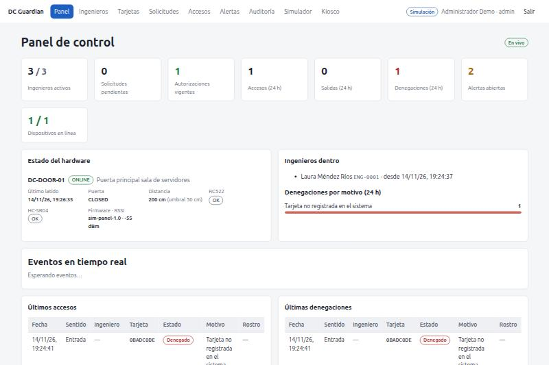

## Índice

1. [Descripción](#1-descripción)
2. [Funcionalidades](#2-funcionalidades)
3. [Arquitectura](#3-arquitectura)
4. [Tecnologías](#4-tecnologías)
5. [Estructura del proyecto](#5-estructura-del-proyecto)
6. [Requisitos de hardware](#6-requisitos-de-hardware)
7. [Conexiones electrónicas](#7-conexiones-electrónicas)
8. [Instalación local](#8-instalación-local)
9. [Instalación con Docker](#9-instalación-con-docker)
10. [Firmware ESP32](#10-firmware-esp32)
11. [Uso del sistema](#11-uso-del-sistema)
12. [Modo simulación y demo guiada](#12-modo-simulación-y-demo-guiada)
13. [Tests](#13-tests)
14. [Seguridad](#14-seguridad)
15. [Capturas de pantalla](#15-capturas-de-pantalla)
16. [Estado del proyecto](#16-estado-del-proyecto)
17. [Autor y licencia](#17-autor-y-licencia)

Documentación detallada:

| Tema | Documento |
|---|---|
| Diseño completo (fuente de verdad) | [docs/FASE1_ARQUITECTURA.md](docs/FASE1_ARQUITECTURA.md) |
| Arquitectura y despliegue | [docs/architecture.md](docs/architecture.md) |
| Instalación paso a paso | [docs/installation.md](docs/installation.md) |
| API REST y WebSocket | [docs/api.md](docs/api.md) |
| Hardware y LCD | [docs/hardware.md](docs/hardware.md) · Cableado: [docs/cableado.md](docs/cableado.md) |
| Protocolo del ESP32 | [docs/protocolo-esp32.md](docs/protocolo-esp32.md) |
| Ampliación Telecom Conecta: QR en la entrada y DHT11 (contrato) | [docs/contrato-qr-dht11.md](docs/contrato-qr-dht11.md) |
| Pruebas de integración y resultados | [docs/pruebas-integracion.md](docs/pruebas-integracion.md) |
| Auditoría de cierre | [docs/AUDITORIA.md](docs/AUDITORIA.md) |
| Convenciones de desarrollo | [CLAUDE.md](CLAUDE.md) · [CONTRIBUTING.md](CONTRIBUTING.md) · [SECURITY.md](SECURITY.md) |

## 1. Descripción

En un centro de datos real, el acceso físico a las salas de servidores se controla con varios
factores, y cada entrada queda registrada. DC Guardian representa ese problema a escala académica:

- Un **administrador** registra al personal (datos y rostro), le asigna tarjetas y le emite una
  **credencial QR**. Los roles de la demo son *Administrador de TI*, *Ingeniero de red*,
  *Personal de limpieza* y *Proveedor*.
- El ingeniero **solicita acceso** a un área para una ventana de tiempo concreta, y un
  administrador **la aprueba o la rechaza**.
- En la **entrada principal**, el kiosco de recepción lee el QR con la webcam. El backend comprueba
  la credencial y la autorización vigente, y el ESP32 enciende el LED verde (o hace parpadear el
  rojo si se deniega).
- En la **sala de servidores**, el ESP32 lee la tarjeta (RC522). El backend comprueba la
  autorización vigente y pide al kiosco que **verifique el rostro** con la webcam. Solo con todo
  correcto envía una orden **firmada** de apertura y el servo abre unos segundos. Desde dentro se
  sale con el **botón de salida** o con una segunda pasada de tarjeta + rostro.
- Dentro de la sala, el **HC-SR04** dispara una alarma de intrusión si detecta a alguien y no hay
  nadie autorizado dentro, y el **DHT11** controla el ventilador y avisa de temperatura o humedad
  fuera de rango.
- Cada intento, decisión y acción administrativa queda en un **registro de auditoría
  encadenado** (cadena de hashes con HMAC) y en una **bitácora** por zona y método. Las anomalías
  generan **alertas** en tiempo real.

## 2. Funcionalidades

| Funcionalidad | Descripción |
|---|---|
| Registro de ingenieros | Alta, edición, estados (`ACTIVO`, `INACTIVO`, `SUSPENDIDO`) y borrado de datos personales (`ELIMINADO`) |
| Registro facial | 3–5 muestras con la webcam, control de calidad (un rostro, tamaño, nitidez, pose) y detección de duplicados |
| Asignación RFID | Registro de tarjetas, vinculación a un ingeniero, bloqueo, pérdida, baja y desbloqueo |
| Credencial QR | Emisión desde la ficha del ingeniero (`DCG-QR1:<token>`), visible **una sola vez** (copiar, PNG o imprimir). Solo se guarda su SHA-256. Una credencial activa por ingeniero; se puede revocar. Puede ser permanente o un **pase temporal** (de 1 hora a 7 días), opcionalmente **de un solo uso**: pensado para proveedores y visitas, se invalida con el primer acceso concedido |
| Solicitudes de autorización | Ventana horaria, área y motivo. Estados `PENDIENTE` → `APROBADA`/`RECHAZADA` → `FINALIZADA`/`EXPIRADA`/`REVOCADA` |
| Aprobación administrativa | Un administrador no puede aprobarse a sí mismo. Suspender a un ingeniero revoca sus autorizaciones |
| Autenticación RFID | El UID solo identifica la tarjeta. La decisión la toma siempre el backend |
| Reconocimiento facial | Verificación 1:1 contra el titular de la tarjeta, con InsightFace `buffalo_l`: 5 fotogramas, al menos 3 coincidencias y *liveness* básica |
| Entrada principal por QR | Página `entrance.html`: la webcam del navegador lee el QR (jsQR) o se pega el texto. Exige ingeniero `ACTIVO`, una solicitud `APROBADA` vigente y el ESP32 en línea. El ESP32 enciende el LED verde de la entrada (5 s) o hace parpadear el rojo. Nunca mueve el servo |
| Alarma de intrusión | HC-SR04 **dentro de la sala**: si detecta a alguien y no hay nadie autorizado dentro, alerta `INTRUSION` y zumbador + LED rojo 20 s. No interviene en la decisión de acceso |
| Apertura de puerta | Servo SG90, solo ante un `GRANTED` firmado de la propia sesión. Cierre automático. **Botón de salida** interior: abre solo si el backend sabe que hay alguien dentro |
| Temperatura y humedad | DHT11 en la sala: lectura cada 2 s y envío cada 10 s. Ventilador desde 27 °C (histéresis de 1 °C), alarma desde 32 °C o con humedad fuera de 20–80 %. Alertas `TEMPERATURA_ALTA`, `TEMPERATURA_CRITICA`, `HUMEDAD_FUERA_DE_RANGO` y `SENSOR_DHT_ERROR` |
| LCD 2004 I2C | Estados en vivo: esperando tarjeta, RFID, verificando, rostro, concedido o denegado (con motivo), puerta, alarma de intrusión, resultado del QR de la entrada, alarma ambiental y errores |
| Dashboard | KPIs, estado del hardware, ingenieros dentro, denegaciones por motivo, tarjeta del **DHT11** (lectura, ventilador, alarma y gráfica de 60 min) y eventos en tiempo real (WebSocket) |
| Bitácora y logs | Bitácora de accesos por zona y método (`QR`, `RFID+ROSTRO`, `BOTON_SALIDA`) y auditoría encadenada verificable desde la interfaz |
| Alertas | Tarjeta o QR desconocidos, fallos repetidos (bloqueo), ingeniero inactivo, rostro no coincidente, intrusión, ambiente fuera de rango, sensor caído, dispositivo sin conexión, firma inválida… |
| Avisos por Telegram | Cada alerta de nivel `WARN` o superior (configurable) llega también a un chat de Telegram: temperatura, intrusión, QR o tarjeta no válidos… Se activa con `DCG_TELEGRAM_BOT_TOKEN` y `DCG_TELEGRAM_CHAT_ID` en `backend/.env`; el envío es asíncrono, con tope por minuto, y un fallo de Telegram nunca afecta al control de acceso. Botón de prueba en **Alertas** |
| Simulación | ESP32 virtual que firma peticiones reales y rostros sintéticos: se prueba todo sin hardware |

## 3. Arquitectura

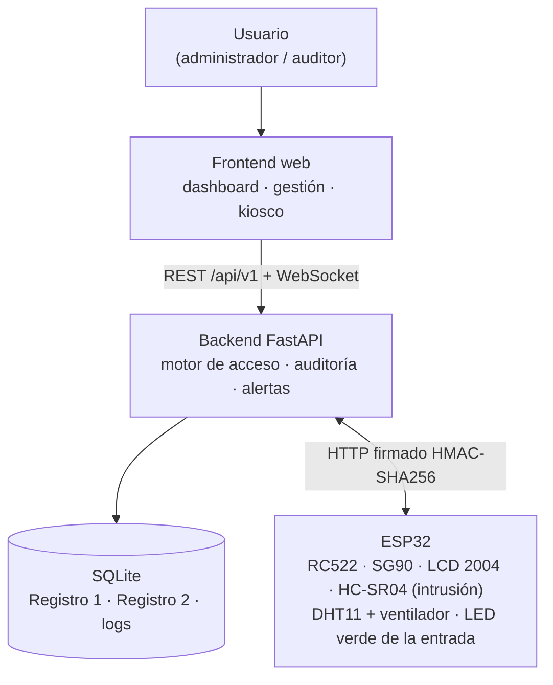

Flujo del reconocimiento facial mediante webcam:

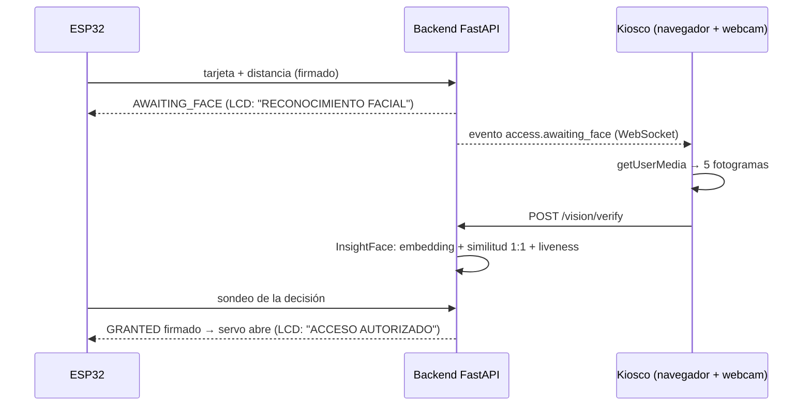

Flujo del código QR en la entrada principal:

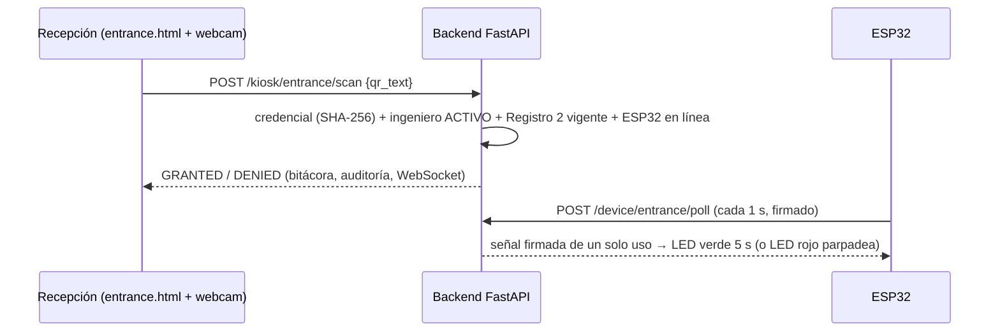

La webcam la abre el **navegador** del kiosco, no Python. Por eso el backend puede ejecutarse en
Docker sin acceso a `/dev/video0`. Detalles en [docs/architecture.md](docs/architecture.md).

## 4. Tecnologías

| Tecnología | Para qué se usa |
|---|---|
| **Python 3.12** | Lenguaje del backend. No sirven 3.13/3.14, por InsightFace y onnxruntime |
| **FastAPI** + Uvicorn | API REST, WebSocket de eventos y servidor de los estáticos del frontend |
| **SQLAlchemy 2** + **Alembic** | ORM y migraciones de la base de datos |
| **SQLite** (modo WAL) | Base de datos en un único archivo |
| **Pydantic** / pydantic-settings | Validación de la API y configuración `DCG_*` |
| **InsightFace** (`buffalo_l`) + **onnxruntime** | Detección facial y embeddings de 512 dimensiones en CPU |
| **OpenCV** (headless) + NumPy | Decodificación de imágenes y métricas de calidad |
| PyJWT · bcrypt · cryptography (Fernet) | Sesión de administrador, hash de contraseñas y cifrado en reposo de los secretos de los dispositivos |
| HTML + CSS + JavaScript (módulos ES) | Frontend sin compilación ni frameworks |
| jsQR 1.4.0 · qrcode-generator 2.0.4 | Lectura del QR con la webcam y dibujo de la credencial (copiados en `frontend/vendor/`, sin CDN) |
| **ESP32** + Arduino-ESP32 + **FreeRTOS** | Firmware de la puerta (C++17) |
| **PlatformIO** | Compilación, carga y pruebas del firmware |
| MFRC522 · ESP32Servo · ArduinoJson · Wire · Adafruit DHT | Lector RFID, servo, JSON del protocolo, bus I2C del LCD y sensor DHT11 |
| **Docker** + Docker Compose | Despliegue reproducible del backend y el frontend |
| pytest · Unity | Pruebas del backend y del firmware |

## 5. Estructura del proyecto

```
.
├── backend/                 FastAPI + SQLAlchemy + Alembic
│   ├── app/core/            configuración, seguridad (bcrypt, JWT, Fernet, HMAC), errores
│   ├── app/models/          Registro 1 (engineers, face_embeddings) · Registro 2 (authorization_requests)
│   │                        · tarjetas, áreas, dispositivos, sesiones de acceso, alertas, auditoría
│   │                        · credenciales QR, eventos de la entrada, lecturas del DHT11
│   ├── app/services/        dominio: access_engine (decisión multifactor), entrance y qr (entrada QR),
│   │                        environment (DHT11), access_log (bitácora), alerts, biometrics, requests, ...
│   ├── app/vision/          FaceProvider: InsightFace (real) y Mock (simulación)
│   ├── app/api/v1/          routers REST, incluido el gateway del ESP32 (device_gateway) y el kiosco
│   ├── app/ws/              eventos en tiempo real (/ws/events)
│   ├── app/sim/             puertas virtuales del panel Simulador
│   ├── app/db/migrations/   migraciones Alembic (0001–0006)
│   ├── scripts/             seed, create_admin
│   ├── tests/               unitarios y de módulo · tests/e2e: flujos completos
│   ├── pyproject.toml       dependencias (fuente de verdad) · uv.lock
│   └── requirements.lock.txt  lock exportado (lo instala Docker)
├── frontend/                HTML/CSS/JS sin build: login, panel, gestión, bitácora, simulador, kiosco y entrada QR
│   └── vendor/              jsQR y qrcode-generator (sin CDN)
├── firmware/esp32-door/     ESP32 (PlatformIO): RC522, HC-SR04, SG90, LCD 2004, DHT11, LED de la entrada, ventilador, HMAC, NTP
├── simulator/               esp32_sim.py: ESP32 virtual (solo biblioteca estándar)
├── docker/                  entrypoint del contenedor
├── docs/                    arquitectura, API, hardware, instalación, protocolo, pruebas
├── screenshots/             capturas reales del dashboard
├── Dockerfile · docker-compose.yml · .dockerignore · .env.example
├── requirements.txt · requirements-dev.txt
├── .claude/agents/          subagentes de desarrollo (hardware, vision, database, backend, frontend, security, integration)
└── data/                    BD, claves de desarrollo, modelos (ignorado por git)
```

## 6. Requisitos de hardware

| Componente | Cantidad | Notas |
|---|---|---|
| ESP32 DevKit v1 (ESP32-WROOM-32) | 1 | Este mapa de pines **requiere una WROOM-32**: en una WROVER los GPIO 16/17 (DHT11 y SCL del LCD) son de la PSRAM ([docs/cableado.md](docs/cableado.md)) |
| Lector RFID RC522 + tarjetas o llaveros MIFARE 13.56 MHz | 1 + n | **Solo 3.3 V** |
| Sensor ultrasónico HC-SR04 | 1 | Dentro de la sala (alarma de intrusión). 5 V; divisor 1 kΩ / 2 kΩ en ECHO |
| Sensor DHT11 (módulo de 3 pines o sensor + 10 kΩ) | 1 | Sala de servidores. **3.3 V**; pull-up de 10 kΩ en DATA |
| LED verde de 5 mm + 220 Ω | 1 | Entrada principal (QR). Distinto del LED verde de la sala |
| LED amarillo + 220 Ω, o relevador + NPN 2N2222/BC547 + 1 kΩ + diodo 1N4007 | 1 | Ventilador de la sala. El relevador, solo a través del transistor |
| LCD 2004 con módulo I2C PCF8574 | 1 | 5 V; conversor de nivel BSS138 recomendado |
| Servomotor SG90 (o MG996R) | 1 | MG996R: fuente externa ≥ 2.5 A |
| Webcam (USB o integrada) | 1 | En el PC del kiosco: rostro (sala) y lectura del QR (entrada) |
| Pulsador de salida (interior) | 1 | Abre solo si el backend sabe que hay alguien dentro |
| 2 LEDs + 220 Ω, zumbador + 2N2222 + 1 kΩ | opcional | Indicaciones de la sala y alarma |
| Protoboard, cables dupont, resistencias 1 kΩ / 2 kΩ, condensador 470–1000 µF | — | |
| Alimentación | — | USB ≥ 1 A para el ESP32 con SG90; fuente de 5 V aparte para el MG996R. **GND común** |
| Computadora | 1 | Linux con Docker o Python 3.12, en la misma red WiFi de 2.4 GHz que el ESP32 |

## 7. Conexiones electrónicas

Copiadas de `firmware/esp32-door/include/pins.h` (fuente de verdad). Diagrama y alimentación en
[docs/cableado.md](docs/cableado.md).

| Componente | Pin del componente | Pin ESP32 | Observaciones |
|---|---|---|---|
| RC522 | SDA (SS) | GPIO 5 | Bus VSPI |
| RC522 | SCK | GPIO 18 | |
| RC522 | MOSI | GPIO 23 | |
| RC522 | MISO | GPIO 19 | |
| RC522 | RST | GPIO 22 | |
| RC522 | 3.3V / GND | 3V3 / GND | **Nunca a 5 V**. IRQ sin conectar |
| HC-SR04 (dentro de la sala) | TRIG | GPIO 26 | |
| HC-SR04 | ECHO | GPIO 27 | **Con divisor**: 1 kΩ en serie y 2 kΩ a GND (5 V → ~3.3 V) |
| HC-SR04 | VCC / GND | 5V (VIN) / GND | |
| Servo SG90 | Señal (naranja) | GPIO 13 | PWM 50 Hz, 500–2400 µs |
| Servo SG90 | V+ (rojo) / GND (marrón) | 5 V / GND común | Condensador de 470 µF junto al servo; nunca desde 3V3 |
| LCD 2004 (PCF8574) | SDA | GPIO 21 | I2C 100 kHz; dirección 0x27 o 0x3F (autodetección) |
| LCD 2004 (PCF8574) | SCL | GPIO 17 | No el 22 por defecto: el GPIO 22 es el RST del RC522 |
| LCD 2004 (PCF8574) | VCC / GND | 5V (VIN) / GND | Las pull-ups del módulo suben SDA y SCL a 5 V: usa un BSS138 o pull-ups a 3.3 V |
| Botón de salida (interior) | un terminal | GPIO 4 | El otro a GND (pull-up interno) |
| LED verde (sala) | ánodo con 220 Ω | GPIO 25 | |
| LED rojo | ánodo con 220 Ω | GPIO 33 | También parpadea si se deniega un QR |
| Zumbador activo | base del 2N2222 con 1 kΩ | GPIO 32 | |
| DHT11 | DATA | GPIO 16 | Pull-up de 10 kΩ a 3.3 V; VCC a 3.3 V |
| LED verde de la entrada principal | ánodo con 220 Ω | GPIO 14 | Señal del QR |
| Ventilador (LED amarillo o relevador) | ánodo con 220 Ω, o base del NPN con 1 kΩ | GPIO 2 | Pin de arranque: la carga lo deja en bajo, que es lo correcto. El LED azul integrado también se enciende |

## 8. Instalación local

Guía completa en [docs/installation.md](docs/installation.md). Requiere Linux y Python 3.12.

```bash
# 1. Clonar
git clone https://github.com/<usuario>/<repositorio>.git dc-guardian && cd dc-guardian

# 2. Entorno virtual e instalación
python3.12 -m venv backend/.venv
backend/.venv/bin/pip install -r requirements-dev.txt
#    (alternativa reproducible con uv: cd backend && uv sync --python 3.12 --extra vision)

# 3. Configuración
cp backend/.env.example backend/.env           # DCG_SIMULATION=true por defecto

# 4. Base de datos y datos de demostración
cd backend
.venv/bin/alembic upgrade head                 # hasta la migración 0006 (QR, entrada, DHT11)
.venv/bin/python -m scripts.seed               # muestra UNA vez el secreto HMAC del ESP32
.venv/bin/python -m scripts.create_admin admin --name "Administrador"

# 5. Backend + frontend (el mismo proceso sirve frontend/)
DCG_SIMULATION=true .venv/bin/uvicorn app.main:app --host 127.0.0.1 --port 8000
```

La semilla carga el escenario Telecom Conecta: las áreas `ENTRADA_PRINCIPAL` y `SALA_SERVIDORES`
(más `NOC` y `ENERGIA`), el dispositivo `DC-DOOR-01`, cuatro ingenieros ficticios (`ENG-0001`
*Administrador de TI*, `ENG-0002` *Ingeniero de red*, `ENG-0003` *Personal de limpieza* y
`ENG-0004` *Proveedor*), cada uno con su tarjeta, y una tarjeta sin asignar (`DEADBEEF`). No crea
administradores, credenciales QR ni solicitudes. Es idempotente, y en una base de datos sembrada
antes de esta fase renombra `SALA-SERVIDORES` a `SALA_SERVIDORES` y actualiza los puestos de los
ingenieros de demostración.

**Atajo: `./run.sh`** hace los pasos 2 a 5 con un solo comando. Comprueba el venv, instala
solo las dependencias que falten, migra la base de datos y carga la semilla solo si la BD está
vacía. Si no hay administrador, ofrece crearlo. Después arranca el backend y espera a que
responda `/api/v1/health`. Por defecto arranca en simulación; `Ctrl+C` lo detiene todo y una
segunda ejecución simultánea se rechaza. Opciones: `--port N`, `--lan` (para el ESP32 físico),
`--real` (InsightFace real), `--reload` y `--help`.

- Aplicación web: <http://localhost:8000>. Inicia sesión con el administrador creado.
- API interactiva: <http://localhost:8000/docs>
- Salud del servicio: <http://localhost:8000/api/v1/health>

**Webcam y reconocimiento facial real**:

1. Arranca con `DCG_SIMULATION=false`. La primera vez se descargan ~300 MB de modelos en `data/models`.
2. Registra los rostros desde la ficha de cada ingeniero.
3. Abre el kiosco en el PC de la puerta: `http://localhost:8000/pages/kiosk.html?device=DC-DOOR-01`.
4. Para la entrada principal, abre `http://localhost:8000/pages/entrance.html?device=DC-DOOR-01`
   en el PC de recepción (menú *Entrada QR*).

La cámara solo funciona en `localhost` o con HTTPS. Los umbrales del DHT11 (`DCG_TEMP_HIGH_C`,
`DCG_TEMP_CRITICAL_C`, `DCG_HUMIDITY_LOW_PCT`, `DCG_HUMIDITY_HIGH_PCT`) y el dispositivo de la
entrada (`DCG_ENTRANCE_DEVICE_CODE`) se configuran en `backend/.env`.

Configuración: [backend/.env.example](backend/.env.example).

- **Desarrollo:** si no defines `DCG_JWT_SECRET` y `DCG_MASTER_KEY`, se generan una vez y se
  guardan en `data/.dev_keys.json` (permisos 600).
- **Producción** (`DCG_ENV=prod`):
  - `DCG_JWT_SECRET` y `DCG_MASTER_KEY` son obligatorias.
  - Hay que definir `DCG_SIMULATION=false`, `DCG_FACE_PROVIDER=insightface` y `DCG_COOKIE_SECURE=true`.
  - El backend se niega a arrancar con simulación o con el proveedor facial mock.
  - `DCG_KIOSK_TOKEN`, si se define, necesita al menos 43 caracteres.
- El extra `vision` (numpy, OpenCV, onnxruntime, InsightFace) es necesario: el backend lo importa al arrancar.

## 9. Instalación con Docker

Necesitas Docker Engine ≥ 24 con el plugin Compose v2. En Ubuntu:
`sudo apt install docker.io docker-compose-v2`, y después añade tu usuario al grupo `docker`.

```bash
cp .env.example .env                    # opcional: puerto, modo, secretos
docker compose build                    # imagen dc-guardian:latest (~1.1 GB)
docker compose up -d                    # migra la BD al arrancar; healthy en ~1 min
docker compose exec dcguardian python -m scripts.seed
docker compose exec -it dcguardian python -m scripts.create_admin admin --name "Administrador"
```

| Acción | Comando |
|---|---|
| Dashboard | <http://localhost:8000> |
| Logs | `docker compose logs -f dcguardian` |
| Detener (conserva los datos) | `docker compose down` |
| Reconstruir tras cambios | `docker compose build && docker compose up -d` |
| Borrar también los datos ⚠ | `docker compose down -v` |

| Servicio | Puerto | Volumen | Notas |
|---|---|---|---|
| `dcguardian` (FastAPI + frontend + InsightFace) | `8000` (`DCG_PORT`) | `dc-guardian-data` → `/data` | Usuario sin root, sistema de archivos de solo lectura, healthcheck `/api/v1/health` |

**Persistencia:** la BD SQLite, las claves de desarrollo y los modelos viven en el volumen
`dc-guardian-data` y sobreviven a `down`, `up` y las reconstrucciones.

**Qué no va en contenedores, y por qué:**
- **Webcam:** la usa el navegador del kiosco en el host.
- **ESP32:** es hardware; se programa con PlatformIO.
- **Base de datos:** es un archivo dentro del volumen.
- **MQTT:** descartado, porque el protocolo es HTTP firmado.

Detalles en [docs/architecture.md §5](docs/architecture.md#5-despliegue-con-docker).

## 10. Firmware ESP32

Guía completa en [docs/installation.md §4](docs/installation.md#4-firmware-esp32) y
[firmware/esp32-door/README.md](firmware/esp32-door/README.md).

1. Instala **PlatformIO** (`pipx install platformio` o la extensión de VS Code). Las librerías
   (MFRC522 1.4.11, ESP32Servo 3.0.6, ArduinoJson 7.2.1, DHT sensor library 1.4.6 y Adafruit
   Unified Sensor 1.1.14) se descargan solas. El LCD solo usa `Wire`. Arduino IDE es posible,
   pero no está probado.
2. Configura WiFi, API y LCD:
   ```bash
   cd firmware/esp32-door
   cp include/dcg_config.example.h include/dcg_config.h    # ignorado por git: nunca lo subas
   ```
   Rellena `DCG_WIFI_SSID`, `DCG_WIFI_PASSWORD`, `DCG_BACKEND_URL` (`http://<IP-del-PC>:8000`,
   con el backend en `--host 0.0.0.0` o Docker), `DCG_DEVICE_ID` y `DCG_DEVICE_SECRET` (el que
   imprimió la semilla). Las opciones del LCD son `DCG_LCD_ENABLED` y `DCG_LCD_I2C_ADDR`
   (`0x00` = autodetección).
3. Compila y carga:
   ```bash
   pio run -e esp32dev -t upload && pio device monitor     # 115200 baudios
   ```
4. Verifica los dispositivos con el firmware de diagnóstico (`pio run -e esp32dev-diag -t upload`).
   Comandos: `rfid`, `dist`, `sweep`, `lcd`, `button`, `dht`, `fan`, `qrled`… El comando `status`
   del firmware normal muestra `online`, `ntp`, la pantalla actual del LCD y el estado del DHT11,
   el ventilador y el LED de la entrada.

## 11. Uso del sistema

1. **Registro del ingeniero:** *Ingenieros → Registrar ingeniero*. El sistema genera el ID `ENG-NNNN`.
2. **Registro facial:** en la ficha del ingeniero, *Registrar rostro*: 3–5 capturas con la webcam
   y control de calidad.
3. **Registro RFID:** *Tarjetas*: registra el UID (lo muestra el firmware de diagnóstico con
   `rfid`) y vincúlalo al ingeniero.
4. **Credencial QR:** en la ficha del ingeniero, *Credencial QR → Generar QR*. El QR se muestra
   **una sola vez** (copiar, descargar PNG o imprimir); generar otro revoca el anterior.
5. **Solicitud de autorización:** *Solicitudes → Nueva solicitud*: ingeniero, tarjeta, área,
   motivo e inicio y duración.
6. **Aprobación:** un administrador la *Aprueba* o la rechaza. Si el administrador es el propio ingeniero, el sistema lo impide (`SELF_AUTHORIZATION`).
7. **Entrada principal:** el ingeniero muestra su QR a la cámara de *Entrada QR*. Si la credencial
   está activa, el ingeniero está `ACTIVO`, tiene una solicitud aprobada y vigente (para cualquier
   área) y el ESP32 está en línea, la página muestra *ACCESO PERMITIDO* y el LED verde de la entrada
   se enciende 5 s; el LCD muestra *ENTRADA PRINCIPAL / ACCESO QR OK*. Si no, la página muestra *ACCESO DENEGADO*, el LCD *QR DENEGADO* y el
   LED rojo parpadea.
8. **Sala de servidores:**
   1. Pasa la tarjeta: *RFID DETECTADO* y después *RECONOCIMIENTO FACIAL*.
   2. Mira al kiosco: si todo cuadra, *ACCESO AUTORIZADO* y *PUERTA ABIERTA*. El servo se
      cierra solo a los 5 s.
   3. Para salir, pulsa el **botón de salida** interior (abre solo si el backend sabe que hay
      alguien dentro; sin conexión no abre) o pasa la tarjeta otra vez y mira al kiosco. La salida
      no exige una autorización vigente: un ingeniero suspendido mientras está dentro puede salir.
9. **Dentro de la sala:** si el HC-SR04 detecta a alguien sin nadie autorizado dentro, suena la
   alarma de intrusión (alerta `INTRUSION`). El DHT11 enciende el ventilador a partir de 27 °C y
   genera alertas de temperatura alta o crítica y de humedad fuera de rango; el panel muestra la
   lectura y la gráfica.
10. **Denegación:** tarjeta o QR desconocidos, bloqueados o revocados, solicitud pendiente, vencida
    o revocada, rostro que no coincide o tiempo agotado. El LCD muestra el motivo y el panel genera
    una alerta.
11. **Registro de eventos:** *Accesos* (bitácora por zona y método, con motivo y puntuación
    facial), *Alertas* (atender) y *Auditoría* (todas las acciones; *Verificar cadena de hashes*).

## 12. Modo simulación y demo guiada

Con `DCG_SIMULATION=true` (por defecto en el compose y en `.env.example`) no hace falta hardware.
La página *Simulador* controla un ESP32 virtual que envía **peticiones HTTP firmadas reales** al
mismo gateway que usa la placa, y los rostros son sintéticos (proveedor `mock`).

1. **Simulador → Rostros de demostración**: registra un rostro sintético a los ingenieros de la semilla.
2. **Solicitudes → Nueva solicitud** para `ENG-0001` con la tarjeta `04A1B2C3`, en el área *Sala de servidores*
   y con inicio ahora. Después, **Aprobar**.
3. **Entrada principal (QR)**:
   1. En **Ingenieros → ENG-0001 → Credencial QR**, pulsa **Generar QR** y **Copiar texto (demostración)**.
   2. Abre **Entrada QR** (`/pages/entrance.html`), pega el texto en *Texto del QR* y pulsa
      **Validar** (o enseña el QR impreso a la webcam, tras **Activar cámara**): *ACCESO PERMITIDO*.
   3. En **Simulador → 4 · Entrada principal (QR)**, **Leer señal de entrada** (o activa el sondeo
      automático): el LED verde virtual se enciende. Un QR inventado o revocado da *QR DENEGADO*.
4. **Sala de servidores (Simulador)**:
   1. Elegir la tarjeta `04A1B2C3` y pulsar **Pasar tarjeta**: el estado pasa a *Esperando rostro*.
   2. **Rostro del titular**: *ACCESO CONCEDIDO*, el servo se abre 5 s y se cierra solo.
   3. **Pasar tarjeta** otra vez y después **Rostro del titular**: se registra la **salida**. Exige rostro, pero no autorización.
5. **Alarmas de la sala (Simulador)**:
   - **Alguien en la sala (10 cm)** sin nadie dentro: alerta `INTRUSION` y alarma en el ESP32 virtual.
   - **5 · Sala de servidores — DHT11**: **Calor (30 °C)** enciende el ventilador
     (`TEMPERATURA_ALTA`); **Crítica (35 °C)** activa la alarma (`TEMPERATURA_CRITICA`); *Sensor con
     fallo* genera `SENSOR_DHT_ERROR`. La tarjeta del DHT11 del panel se actualiza en vivo.
6. Para probar denegaciones:
   - **Rostro de otro ingeniero** o **Persona desconocida**.
   - El UID `0BADC0DE` (tarjeta no registrada).
   - Desmarcar **HC-SR04 responde** (`SENSOR_FAULT`) o **ESP32 conectado**; a los ~50 s aparece `DEVICE_OFFLINE` y el QR se deniega con ese motivo.
   - Revocar la solicitud, revocar el QR o suspender al ingeniero.
7. **Panel**: estado del hardware, ingenieros dentro, accesos, denegaciones por motivo, DHT11, alertas y eventos en tiempo real.
   **Accesos**: bitácora con las dos zonas (filtros por zona y método). **Auditoría → Verificar cadena de hashes.**

Con la webcam real: abre **Kiosco** (`/pages/kiosk.html?device=DC-DOOR-01`) en el PC de la puerta, con la sesión de
administrador iniciada o con el token de `GET /api/v1/system/kiosk-token`. Si lo abres con `?token=`, la página guarda el token y lo quita de la URL. Para rostros reales hay que arrancar sin
`DCG_SIMULATION` (proveedor InsightFace; el modelo se descarga en `data/models` la primera vez) y registrar los rostros
con la cámara desde la ficha del ingeniero.

### ESP32 virtual por línea de comandos

```bash
python3 simulator/esp32_sim.py --url http://localhost:8000 --device DC-DOOR-01 --secret <secreto> heartbeat
python3 simulator/esp32_sim.py --url http://localhost:8000 --device DC-DOOR-01 --secret <secreto> access --uid 04A1B2C3
```

Usa el mismo protocolo firmado que el firmware. Mientras espera la decisión, mira el rostro en el kiosco.
`python3 simulator/esp32_sim.py --help` lista el resto de subcomandos.

## 13. Tests

```bash
cd backend && .venv/bin/pytest                          # 260 tests: unitarios, de módulo, E2E (incluidos QR, DHT11, intrusión y botón de salida) y regresiones de seguridad
cd firmware/esp32-door && ../../.tools/bin/pio test -e native                # 129 tests de la lógica del firmware (9 suites: LCD, entrada QR, DHT11, ...)
cd firmware/esp32-door && ../../backend/.venv/bin/pytest test/integration    # 13 tests: firmware real ↔ gateway por HTTP
```

Cifras de la última ejecución (2026-11-17), todas en verde.

Resultados y matriz de escenarios: [docs/pruebas-integracion.md](docs/pruebas-integracion.md).

## 14. Seguridad

Política de vulnerabilidades: [SECURITY.md](SECURITY.md).

- **Limitaciones del RFID:** el UID de una MIFARE Classic se lee y se clona con facilidad. En
  DC Guardian el UID **solo identifica**; el acceso exige además una autorización vigente y el
  rostro del titular. Tres fallos en 5 min bloquean la tarjeta 10 min.
- **Credencial QR:** también **solo identifica**: cada escaneo exige además una solicitud aprobada
  y vigente. Solo se guarda el SHA-256 del token (el texto se muestra una vez), hay como máximo una
  credencial activa por ingeniero y el escaneo está limitado a 20 por minuto por cliente. Un QR
  fotografiado sirve mientras no se revoque (es un factor débil): solo enciende el LED de la
  entrada principal y nunca abre la sala.
- **Datos biométricos:**
  - Se guardan solo embeddings (vectores), nunca fotografías.
  - Los fotogramas del kiosco se procesan en memoria y no se escriben a disco.
  - El borrado de un ingeniero elimina sus datos personales y biométricos.
  - `data/` (BD, modelos y claves) está en `.gitignore` y en `.dockerignore`.
- **Autorizaciones:**
  - Solo el Registro 2 concede acceso.
  - Las ventanas horarias se comprueban en el servidor.
  - Nadie puede autoaprobarse.
  - Suspender a un ingeniero revoca sus autorizaciones.
  - El ESP32 nunca decide: solo abre con una respuesta **firmada (HMAC-SHA256)** ligada al
    nonce de su propia petición, lo que evita falsificaciones y reinyecciones.
- **Logs:** la auditoría es una cadena de hashes con clave, y se puede verificar desde la UI.
  Las sesiones de acceso guardan el motivo y la puntuación facial; la bitácora reúne la sala y la
  entrada principal.
- **Fail-closed en el hardware:** sin backend o con una firma inválida, el LED de la entrada no se
  enciende y el botón de salida no abre; la alarma de intrusión suena en local y el ventilador
  pasa a control local con el mismo umbral.
- **Limitaciones del prototipo:**
  - HTTP sin TLS en la LAN por defecto: el tráfico se puede leer, pero no falsificar.
  - El secreto del ESP32 queda en su flash sin cifrar.
  - El *liveness* es básico: no detecta máscaras ni vídeos de calidad.
  - El umbral facial no está calibrado con una población real.
  - Una sola instancia y SQLite.
  - **No apto para un control de acceso real.**

## 15. Capturas de pantalla

Capturas reales del sistema ejecutándose en Docker en modo simulación, con los datos ficticios
de la semilla (`screenshots/`):

| | |
|---|---|
|  Panel de control | 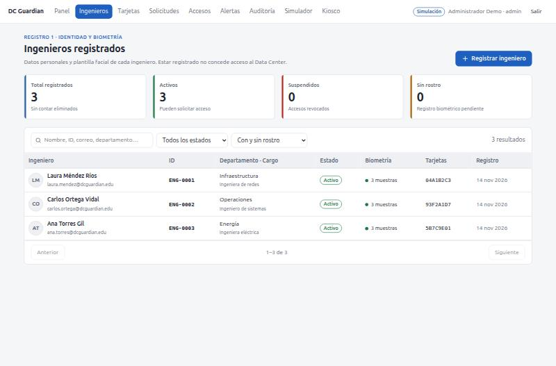 Registro de ingenieros |
| 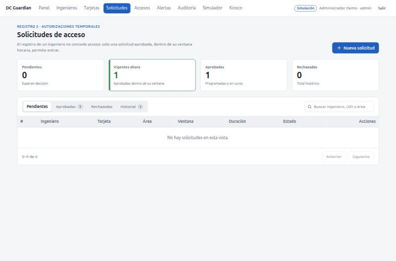 Solicitudes de acceso | 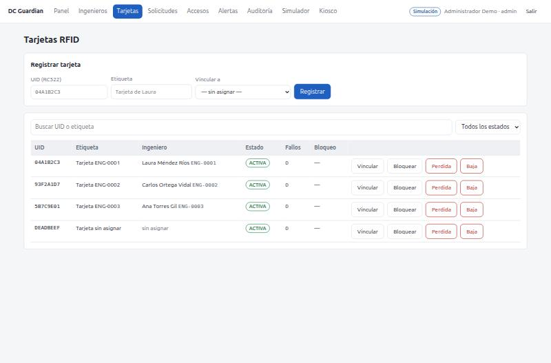 Tarjetas RFID |
| 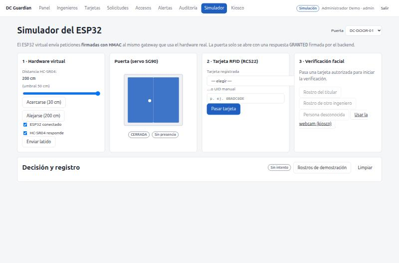 Simulador del ESP32 | 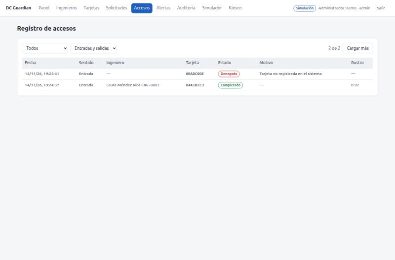 Registro de accesos |
| 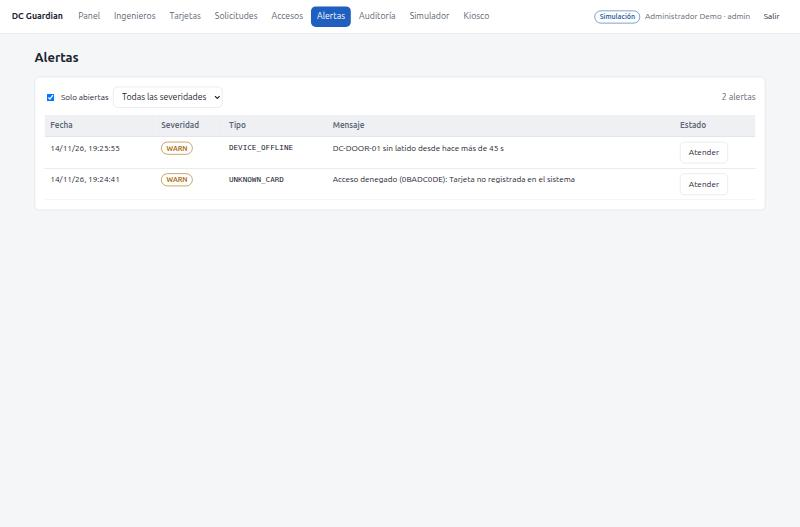 Alertas | 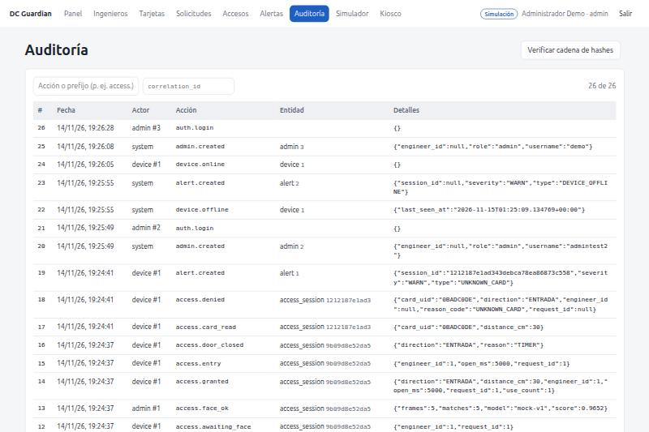 Auditoría encadenada |

No se incluye el kiosco con cámara: el navegador usado para las capturas no tenía acceso a la webcam.
Las capturas son anteriores a la ampliación Telecom Conecta: aún no hay capturas de la entrada QR,
la credencial QR ni la tarjeta del DHT11.

## 16. Estado del proyecto

| Componente | Estado |
|---|---|
| Backend: dominio, motor de acceso, gateway HMAC, alertas, WebSocket, auditoría | ✅ Implementado · 260 tests |
| Telecom Conecta: credencial y acceso QR en la entrada, DHT11 + ventilador, bitácora por zona y método (migración 0006) | ✅ Implementado y probado en simulación (E2E) |
| Frontend: panel (con DHT11), ingenieros (con credencial QR), tarjetas, solicitudes, bitácora, alertas, auditoría, simulador, kiosco, entrada QR | ✅ Implementado |
| Modo simulación (ESP32 virtual + rostros sintéticos) | ✅ Implementado y verificado de extremo a extremo (también en Docker) |
| Docker (imagen única + compose + volumen) | ✅ Verificado: build, healthcheck, flujo completo de acceso, persistencia tras reinicio, carga de InsightFace |
| Reconocimiento facial con InsightFace | 🧪 Experimental: el modelo carga y procesa imágenes; **umbral sin calibrar** con rostros reales |
| Kiosco con webcam real | 🧪 Implementado; no verificado con cámara en esta entrega |
| Firmware ESP32 (RC522, HC-SR04 de intrusión, SG90, botón de salida, HMAC) | 🧪 Compila (`esp32dev`); pasa 129 tests en PC y 13 contra el gateway; **sin probar en placa real** |
| Firmware: LED de la entrada, DHT11 y ventilador | 🧪 Implementado y probado en PC; **sin probar con los componentes físicos** |
| LCD 2004 I2C | 🧪 Implementado (driver + máquina de estados con 20 tests); **sin probar con pantalla física** |
| HTTPS / proxy inverso | ⏳ No incluido (documentado como opcional) |

Fases de desarrollo: F1 diseño · F2 base · F3 dominio · F4 visión · F5 motor y gateway ·
F6 frontend · F7 firmware · F8 integración · F9 cierre (LCD, Docker, documentación) ·
F10 ampliación Telecom Conecta (HC-SR04 como alarma de intrusión, botón de salida, QR en la
entrada, DHT11).

## 17. Autor y licencia

- **Autores:** Santiago Martín Montes Rubio y Claude Code (Anthropic)
- **Contacto:** [@santymontes234-a11y](https://github.com/santymontes234-a11y)
- **Licencia:** [MIT](LICENSE). Puedes usar, modificar y redistribuir el código siempre que conserves el aviso de copyright.

Proyecto académico. Los nombres, áreas y personas de los datos de demostración son ficticios.
