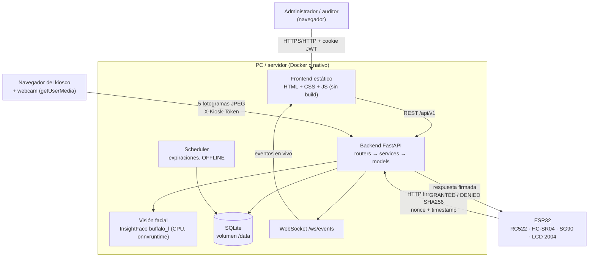
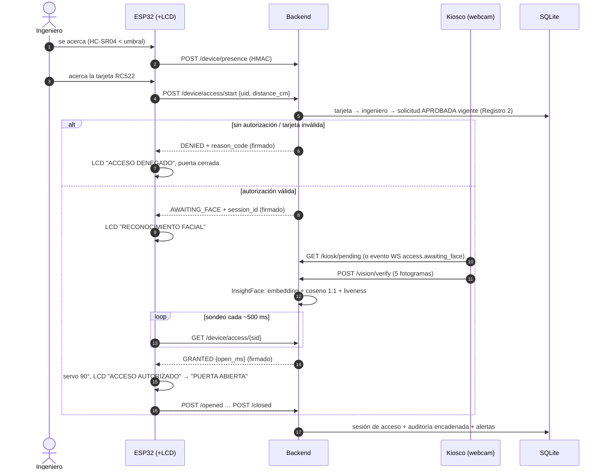
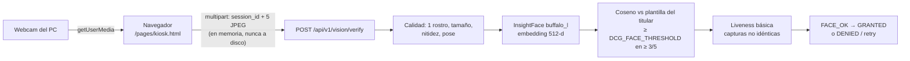
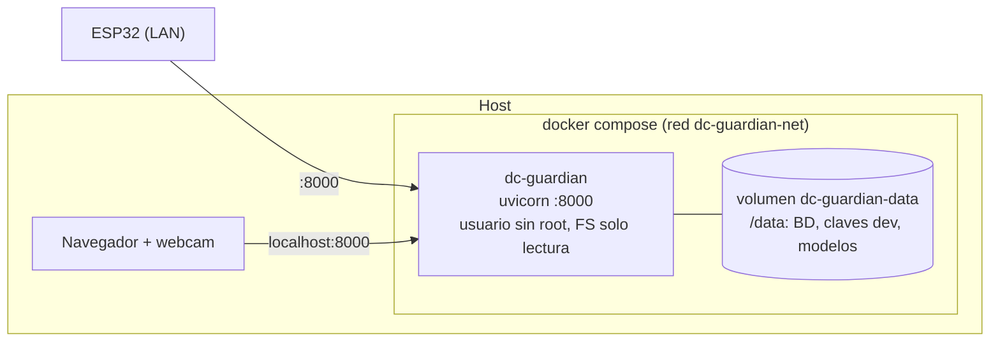

# Arquitectura de DC Guardian

Resumen de la arquitectura implementada. El diseño completo (modelo de datos, máquinas de
estados, amenazas, plan de fases) está en [FASE1_ARQUITECTURA.md](FASE1_ARQUITECTURA.md); el
protocolo del ESP32 en [protocolo-esp32.md](protocolo-esp32.md) y la API en [api.md](api.md).

## 1. Componentes



| Componente | Tecnología | Responsabilidad |
|---|---|---|
| Frontend | HTML/CSS/JS nativos, módulos ES | Login, panel, ingenieros, tarjetas, solicitudes, accesos, alertas, auditoría, simulador, kiosco |
| Backend | FastAPI, Pydantic, SQLAlchemy 2, Alembic | Dominio, motor de acceso multifactor, gateway del ESP32, auditoría encadenada |
| Visión | InsightFace + onnxruntime + OpenCV headless | Calidad de imagen, registro (3–5 muestras), verificación 1:1, liveness básica |
| Base de datos | SQLite (WAL) | Registro 1, Registro 2, sesiones de acceso, alertas, auditoría |
| Tiempo real | WebSocket nativo de Starlette | Eventos `access.*`, `alert.*`, `device.*`, `request.*` |
| Firmware | C++17, PlatformIO, Arduino-ESP32, FreeRTOS | Sensores, puerta fail-closed, cliente HMAC, LCD |

## 2. Regla fundamental

- **Registro 1** (`engineers`, `face_embeddings`): identidad y biometría. **Nunca concede acceso.**
- **Registro 2** (`authorization_requests`): solicitudes aprobadas con ventana horaria. Es lo
  **único** que consulta el motor de acceso.
- **Fail-closed**: cualquier error, timeout, firma inválida o pérdida de red deja la puerta
  cerrada. El ESP32 no decide nunca: solo abre ante un `GRANTED` firmado para la sesión que él
  inició. El HC-SR04 está **dentro** de la sala y solo sirve de alarma de intrusión: no es un
  factor de acceso (protocolo §9).
- **Entrada principal (QR)**: el kiosco lee el QR del ingeniero y el backend comprueba la
  credencial y el Registro 2. El ESP32 solo recibe una señal firmada y enciende un LED verde
  (GPIO 14); nunca mueve el servo de la sala (protocolo §10).
- **DHT11**: temperatura y humedad de la sala cada 10 s. El backend decide ventilador y alarma;
  sin backend o con firma inválida, el ESP32 decide en local con los mismos umbrales
  (protocolo §11).

## 3. Flujo de acceso (entrada)



La **salida** (segundo paso de tarjeta del mismo ingeniero que está dentro) exige la misma verificación facial 1:1, pero **no** una autorización vigente: un ingeniero suspendido mientras está dentro puede salir.

## 4. Webcam y reconocimiento facial



Decisión de despliegue: la webcam **no** se expone a ningún contenedor. El navegador del
kiosco la abre en el host y envía las imágenes por HTTP; la inferencia corre dentro del
backend. `getUserMedia` solo funciona en contexto seguro: `http://localhost` en el mismo PC, o
HTTPS si el kiosco se abre desde otro equipo.

## 5. Despliegue con Docker



| Servicio evaluado | Decisión | Motivo |
|---|---|---|
| Backend + frontend | **Contenedor `dcguardian`** | FastAPI sirve los estáticos y el WebSocket desde el mismo origen (cookies `SameSite=Strict`, sin CORS) |
| Base de datos | Volumen, sin contenedor | SQLite es un archivo |
| Reconocimiento facial | Dentro del backend | Ya es una capa del backend; un servicio aparte solo añadiría latencia y otra API |
| Webcam | En el host (navegador) | No hace falta `--device /dev/video0` |
| MQTT (Mosquitto) | Descartado | El protocolo del ESP32 es HTTP firmado; un broker no añade nada al prototipo |
| Nginx | Opcional, no incluido | Útil solo para HTTPS (kiosco en otro equipo, `DCG_COOKIE_SECURE=true`) |

Restricción: **una sola réplica y un solo worker**. El hub de WebSocket, el limitador de login y
las puertas virtuales del simulador viven en la memoria del proceso.

## 6. Capas del backend

```
app/api/v1/      routers (sin lógica): validación HTTP, dependencias de auth
app/services/    dominio: access_engine, requests, engineers, biometrics, alerts, audit, scheduler
app/models/      SQLAlchemy (estados como StrEnum en español: PENDIENTE, APROBADA, ...)
app/vision/      FaceProvider: InsightFace (real) y Mock (simulación)
app/ws/          hub de eventos (se publican tras el commit)
app/sim/         ESP32 virtual que firma peticiones reales contra el propio gateway
app/core/        configuración DCG_*, seguridad (bcrypt, JWT, Fernet, HMAC), errores de dominio
```
