# DC Guardian — Reporte técnico y funcional

**Sistema académico de control de acceso inteligente a un Data Center**

| Campo | Valor |
|---|---|
| Proyecto | DC Guardian — Intelligent Data Center Access Control System |
| Descripción breve | Control de acceso multifactor a una sala de un centro de datos ficticio: tarjeta RFID, reconocimiento facial 1:1 con IA, autorización temporal aprobada y una puerta (servo) gobernada por un ESP32 que solo obedece órdenes firmadas |
| Fecha de elaboración | 15 de noviembre de 2026 |
| Autoría del proyecto | Santiago Martín Montes Rubio y Claude Code (Anthropic), según el README |
| Repositorio | https://github.com/santymontes234-a11y/dc-guardian (licencia MIT) |
| Tecnologías principales | Python 3.12, FastAPI, SQLAlchemy 2, Alembic, SQLite, InsightFace (buffalo_l) + onnxruntime, OpenCV, HTML/CSS/JavaScript, ESP32 (C++17, Arduino-ESP32, FreeRTOS, PlatformIO), Docker Compose, pytest, Unity |
| Estado analizado | Rama `main` local (commit `59d30d5`) **más** cambios sin confirmar en el árbol de trabajo (34 archivos modificados y 2 pruebas nuevas) |

> **Criterio de este reporte.** Todo lo afirmado se comprobó en el código, la documentación, la ejecución de las pruebas o la base de datos local del proyecto. Lo que no se pudo comprobar se marca expresamente como **no verificado**. Las cifras de ejecución corresponden al 15-11-2026.

## Índice

<!-- INDICE -->

## 1. Resumen ejecutivo

DC Guardian es un prototipo académico que reproduce, a pequeña escala, el control de acceso físico a una sala de servidores. Para abrir la puerta exige que coincidan varios factores independientes: una **tarjeta RFID** registrada y activa, una **autorización temporal aprobada** por un administrador para esa área y esa ventana horaria, y el **rostro del titular**, verificado 1:1 por un modelo de inteligencia artificial (InsightFace `buffalo_l`) a partir de cinco fotogramas de una webcam.

La decisión la toma siempre el **backend** (FastAPI). El **ESP32** de la puerta solo lee la tarjeta, informa de su estado y mueve el servo cuando recibe una respuesta `GRANTED` **firmada con HMAC-SHA256** y ligada a su propia petición. Ante cualquier error, duda o pérdida de comunicación, la puerta permanece cerrada (*fail-closed*).

Sus principales aportaciones son:

- Una **regla de diseño explícita**: el registro de identidad y biometría (Registro 1) nunca concede acceso; solo lo hace una solicitud aprobada y vigente (Registro 2).
- Un **protocolo dispositivo–servidor** autenticado en ambos sentidos, con *nonce*, marca de tiempo y protección contra reinyección.
- Una **auditoría encadenada** (cadena de hashes con HMAC) verificable desde la interfaz.
- Un **modo simulación** completo (ESP32 virtual y rostros sintéticos) que permite demostrar y probar todo sin hardware.
- Una base de pruebas amplia: **321 pruebas automatizadas aprobadas** el 15-11-2026 (222 del backend, 86 nativas del firmware y 13 de integración del firmware).

La base de datos local contiene además el registro de una **sesión de pruebas con el ESP32 físico y el modelo facial real** (15-11-2026): 39 intentos de acceso, 11 aperturas correctas y 9 verificaciones faciales con similitudes entre 0,29 y 0,84. Esta prueba no está documentada formalmente en `docs/` y se analiza en la sección 15.

## 2. Introducción

Los centros de datos alojan la infraestructura crítica de una organización. Además de la seguridad lógica, su **seguridad física** —quién entra en cada sala, cuándo y con qué permiso— es un requisito básico: un acceso indebido permite manipular equipos, extraer discos o interrumpir servicios. Por eso es habitual combinar varios factores (algo que se tiene, algo que se es, un permiso vigente) y registrar cada intento.

DC Guardian aborda este problema como proyecto académico de fin de curso. Integra en un mismo sistema electrónica embebida (ESP32 con lector RFID, sensor ultrasónico, servomotor y pantalla LCD), un backend web con lógica de dominio, visión por computador con un modelo de reconocimiento facial preentrenado, y una interfaz web de administración y monitoreo en tiempo real. El valor del proyecto está tanto en la funcionalidad como en las decisiones de seguridad que la sostienen y en la trazabilidad de todas las acciones.

El propio repositorio advierte que se trata de un prototipo **no apto para un control de acceso real** (README, §14).

## 3. Problemática

**Problema identificado.** Controlar el acceso a una sala crítica con un solo factor, o dejando la decisión en el propio dispositivo de la puerta, es insuficiente y difícil de auditar.

**Causas** (recogidas en el análisis de riesgos del diseño, `docs/FASE1_ARQUITECTURA.md` §10, y en la sección de seguridad del README):

- El UID de una tarjeta MIFARE Classic se lee y se clona con facilidad (riesgo R6).
- Estar dado de alta como ingeniero no implica tener permiso en un momento dado; los permisos deben ser temporales y revocables.
- Si la cerradura decide localmente, basta con manipularla o suplantar al servidor (riesgo R7: *replay* o suplantación del ESP32 en la red).
- Una fotografía o una pantalla pueden engañar a un reconocimiento facial ingenuo (riesgo R3).
- Sin un registro íntegro no es posible reconstruir ni auditar lo ocurrido.

**Consecuencias.** Accesos no autorizados con tarjetas copiadas o prestadas, personas con permisos vencidos o suspendidos que siguen entrando, órdenes de apertura falsificadas y ausencia de evidencia fiable para investigar incidentes.

**Necesidades que justifican el desarrollo:**

1. Exigir varios factores independientes y una autorización temporal aprobada por una persona distinta del solicitante.
2. Centralizar la decisión en un servidor y autenticar criptográficamente al dispositivo y a sus respuestas.
3. Fallar en cerrado ante cualquier anomalía.
4. Registrar cada intento, decisión y acción administrativa de forma verificable, y alertar en tiempo real.
5. Poder demostrar y probar el sistema sin depender del hardware.

No se aportan estadísticas externas sobre incidentes de seguridad física porque el repositorio no contiene ninguna fuente de ese tipo.

## 4. Objetivos

### 4.1 Objetivo general

Diseñar e implementar un sistema que conceda el acceso a una sala de un Data Center **solo** cuando coinciden la tarjeta RFID, el rostro del titular y una autorización temporal aprobada, con una puerta que falla en cerrado, comunicación autenticada con el dispositivo y una auditoría verificable de todas las acciones.

### 4.2 Objetivos específicos

Derivados de los requisitos funcionales RF-01 a RF-11 del documento de diseño:

1. Registrar ingenieros, sus muestras faciales (embeddings) y sus tarjetas RFID, sin que el registro conceda acceso (RF-01, RF-02).
2. Gestionar solicitudes de autorización temporales por ingeniero, tarjeta y área, con aprobación, rechazo, revocación y expiración automática (RF-03 a RF-05).
3. Implementar un motor de acceso multifactor que combine autorización vigente, tarjeta, vínculo tarjeta–ingeniero, rostro, estado del ingeniero y validación en el backend (RF-06).
4. Abrir el servo únicamente tras una decisión `GRANTED` firmada por el backend (RF-07).
5. Mantener una auditoría inmutable de todos los eventos y generar alertas ante anomalías (RF-08, RF-09).
6. Ofrecer un modo de simulación completo sin hardware (RF-10).
7. Proporcionar un panel web de administración, monitoreo en tiempo real y un kiosco de verificación facial (RF-11).

## 5. Justificación

- **Técnica.** El proyecto integra cuatro dominios (firmware embebido, backend, visión por computador e interfaz web) bajo un contrato común y documentado. Aplica patrones relevantes en la industria: arquitectura por capas, máquinas de estados explícitas, autenticación de mensajes con HMAC y *nonce*, cifrado en reposo, migraciones versionadas, pruebas unitarias, de integración y de extremo a extremo, y despliegue reproducible con Docker.
- **Académica.** Permite trabajar de forma práctica conceptos de seguridad (modelo de amenazas, *fail-closed*, no repudio, protección contra *replay*), de sistemas embebidos (FreeRTOS, buses SPI e I2C, PWM) y de inteligencia artificial aplicada (embeddings faciales, similitud coseno, umbrales y sus límites).
- **Organizacional.** Aunque es un prototipo, reproduce el flujo de un control de acceso real (alta, solicitud, aprobación, acceso, auditoría) y puede servir como base didáctica o como prueba de concepto.
- **Ética y privacidad.** El tratamiento de datos biométricos se minimiza: solo se guardan embeddings cifrados, nunca fotografías, y existe un procedimiento de borrado de datos personales.

## 6. Alcance

### 6.1 Funcionalidades incluidas

- Gestión de ingenieros (alta, edición, estados `ACTIVO`/`INACTIVO`/`SUSPENDIDO` y borrado de datos personales `ELIMINADO`).
- Registro facial con 3–5 muestras, control de calidad y detección de duplicados.
- Gestión de tarjetas RFID (alta, vinculación, bloqueo, pérdida, baja y desbloqueo).
- Gestión de áreas y dispositivos (incluida la rotación del secreto del dispositivo).
- Solicitudes de autorización con máquina de estados y prohibición de autoaprobación.
- Motor de acceso multifactor para entrada y salida.
- Gateway HTTP firmado para el ESP32.
- Kiosco facial en el navegador con webcam.
- Alertas, auditoría encadenada, panel en tiempo real (WebSocket).
- Simulador del ESP32 en la web y por línea de comandos.
- Firmware del ESP32 con LCD 2004, firmware de diagnóstico y despliegue en Docker.
- En el árbol de trabajo (sin confirmar en git): **botón de salida interior** y **alarma de intrusión** con el HC-SR04 dentro de la sala.

### 6.2 Procesos que realiza

Alta de identidades y biometría → solicitud y aprobación de permisos → verificación multifactor en la puerta → apertura o denegación → registro, alertas y notificación en tiempo real → expiración automática de permisos y detección de dispositivos sin conexión.

### 6.3 Usuarios

| Rol | Capacidades |
|---|---|
| `admin` | Gestión completa: ingenieros, rostros, tarjetas, áreas, dispositivos, solicitudes, alertas, simulador |
| `auditor` | Rol de solo consulta definido en `AdminRole` (panel, registros y auditoría) |
| Ingeniero | No usa la aplicación: es el sujeto del acceso (tarjeta + rostro en la puerta) |
| Kiosco | Navegador junto a la puerta autenticado con un token de kiosco |
| Dispositivo (ESP32) | Se autentica con su secreto HMAC en el gateway `/device/*` |

### 6.4 Limitaciones de alcance y aspectos excluidos

- No hay portal para que el ingeniero cree sus propias solicitudes: las registra el administrador (decisión de diseño 2 de la F1).
- No incluye HTTPS ni proxy inverso (documentado como opcional).
- Una sola instancia del backend y un solo *worker*; base de datos SQLite.
- No hay sensor de puerta (*reed switch*): el cierre se asume por temporizador.
- La prueba de vida facial es básica (rechaza fotogramas idénticos); no detecta máscaras ni vídeos.
- MQTT y un contenedor de base de datos se descartaron explícitamente.
- No hay despliegue público del proyecto.

## 7. Tecnologías utilizadas

| Categoría | Tecnología | Función en el proyecto | Motivo de la elección (según la documentación) |
|---|---|---|---|
| Lenguaje (backend) | Python 3.12 | Backend, visión, scripts, simulador | 3.13/3.14 no son compatibles con InsightFace/onnxruntime |
| Framework web | FastAPI + Uvicorn | API REST, WebSocket y servidor de estáticos | Validación con Pydantic, rendimiento, documentación automática en `/docs` |
| ORM y migraciones | SQLAlchemy 2 + Alembic | Modelos y 5 migraciones versionadas | Migración futura a PostgreSQL sin reescribir lógica |
| Base de datos | SQLite (modo WAL) | Persistencia en un archivo | Simplicidad; un solo proceso |
| Validación y configuración | Pydantic / pydantic-settings | Esquemas de la API y variables `DCG_*` | Validación declarativa y comprobaciones de coherencia al arrancar |
| IA / visión | InsightFace `buffalo_l` + onnxruntime | Detección facial y embeddings de 512 dimensiones en CPU | Modelo preentrenado de alta precisión, sin GPU |
| Imagen | OpenCV (headless) + NumPy | Decodificación y métricas de calidad | Variante sin dependencias gráficas para contenedores |
| Seguridad | PyJWT, bcrypt, cryptography (Fernet), HMAC-SHA256 | Sesión de administrador, contraseñas, cifrado en reposo, firma de mensajes y de la auditoría | Primitivas estándar y bien probadas |
| Frontend | HTML + CSS + JavaScript (módulos ES) | 12 páginas sin paso de compilación | Sin dependencias ni *build* |
| Tiempo real | WebSocket (Starlette) | Eventos `access.*`, `alert.*`, `device.*`, `request.*` | Actualización inmediata del panel y del kiosco |
| Captura de cámara | `getUserMedia` del navegador | Webcam del kiosco | Evita dar acceso a `/dev/video0` al backend o a Docker |
| Microcontrolador | ESP32 DevKit v1 (WROOM-32) | Controlador de la puerta | WiFi integrado, RNG por hardware, FreeRTOS |
| Firmware | C++17, Arduino-ESP32, FreeRTOS, PlatformIO | Lógica de la puerta y E/S | Lógica pura separada del hardware y probada en PC |
| Librerías de firmware | MFRC522 1.4.11, ESP32Servo 3.0.6, ArduinoJson 7.2.1, Wire | RFID, servo, JSON, I2C del LCD | Versiones fijadas en `platformio.ini` |
| Contenedores | Docker + Docker Compose | Despliegue reproducible (imagen única, volumen de datos) | Usuario sin root, sistema de archivos de solo lectura, *healthcheck* |
| Gestión de dependencias | uv (`uv.lock`), `requirements.lock.txt` | Instalación reproducible | Versiones fijadas |
| Pruebas | pytest, Unity (PlatformIO) | Pruebas del backend y del firmware | — |
| Herramientas de desarrollo | Claude Code con 7 subagentes (`.claude/agents/`) | Desarrollo asistido por dominios (hardware, visión, datos, backend, frontend, seguridad, integración) | Separación de responsabilidades por archivos |

**Servicios externos.** El sistema no depende de APIs externas en tiempo de ejecución. La única descarga externa es la del modelo `buffalo_l` (~300 MB) la primera vez que se arranca con reconocimiento facial real; en este equipo el modelo ya está descargado en `data/models/` (601 MB contando el ZIP).

**Infraestructura.** Un PC Linux (nativo o Docker) en la misma red WiFi de 2,4 GHz que el ESP32. El script `run.sh` arranca todo con un solo comando (opciones `--lan`, `--real`, `--reload`, `--port`).

## 8. Arquitectura del sistema

### 8.1 Arquitectura general

El sistema es un **monolito modular**: un único proceso FastAPI sirve la API, el WebSocket y el frontend estático, y contiene el motor de acceso, la visión facial, la auditoría, las alertas y un planificador. Fuera del proceso quedan tres clientes: el navegador del administrador, el navegador del kiosco con la webcam y el ESP32.

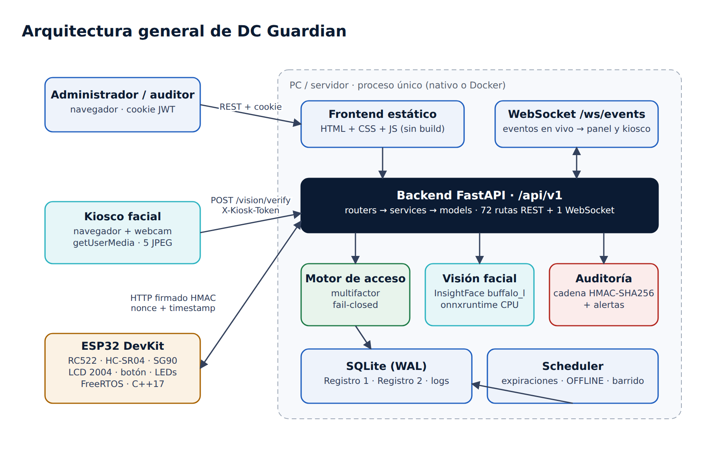

### 8.2 Componentes y módulos

| Capa / módulo | Ubicación | Responsabilidad |
|---|---|---|
| Routers (sin lógica) | `backend/app/api/v1/` | 72 rutas REST (10 solo en simulación, 8 del gateway del ESP32) y validación HTTP |
| Servicios de dominio | `backend/app/services/` | `access_engine`, `requests`, `engineers`, `biometrics`, `cards`, `facility`, `alerts`, `audit`, `auth`, `scheduler` |
| Modelos | `backend/app/models/` | Entidades SQLAlchemy; estados como `StrEnum` en español (`PENDIENTE`, `APROBADA`…) |
| Visión | `backend/app/vision/` | `FaceProvider` con dos implementaciones: InsightFace (real) y Mock (simulación); control de calidad |
| Tiempo real | `backend/app/ws/` | Hub de eventos; publica **después** del *commit* |
| Simulación | `backend/app/sim/`, `simulator/esp32_sim.py` | Puertas virtuales que firman peticiones reales |
| Núcleo | `backend/app/core/` | Configuración `DCG_*`, seguridad (bcrypt, JWT, Fernet, HMAC), errores de dominio, limitador de intentos |
| Frontend | `frontend/` | 12 páginas HTML con módulos JavaScript por página |
| Firmware | `firmware/esp32-door/` | `lib/dcg_core` (lógica pura probada en PC) y `src/` (E/S, red, LCD, diagnóstico) |

### 8.3 Flujo de información (entrada)

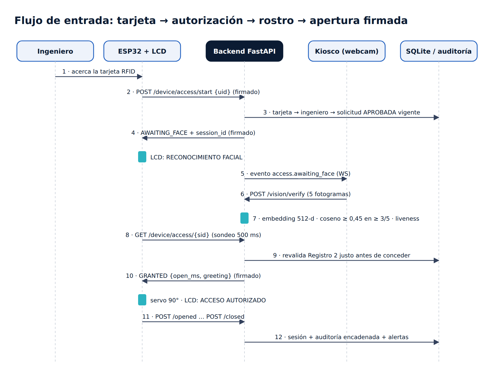

El motor de acceso consulta el Registro 2 en **tres momentos**: al leer la tarjeta, tras la verificación facial y justo antes de conceder. Así, una autorización revocada entre el rostro y la apertura también se deniega (prueba `test_revoked_between_face_and_opening`).

### 8.4 Máquinas de estados

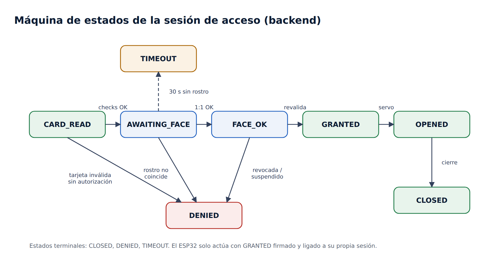

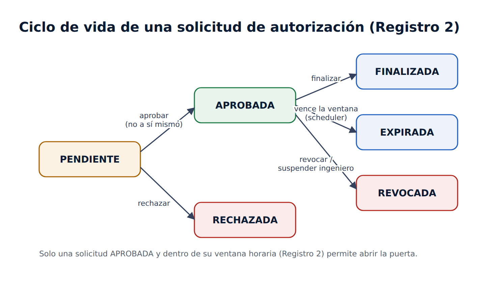

En el firmware existen dos máquinas adicionales (`firmware/esp32-door/README.md`): la del sistema (`BOOT → IDLE ⇄ PRESENCE → CARD_READ → WAITING_DECISION → DOOR_OPEN → DOOR_CLOSING → IDLE`, con `OFFLINE` y `ERROR`) y la de la puerta (`CLOSED → OPENING → OPEN → CLOSING → CLOSED`).

### 8.5 Hardware

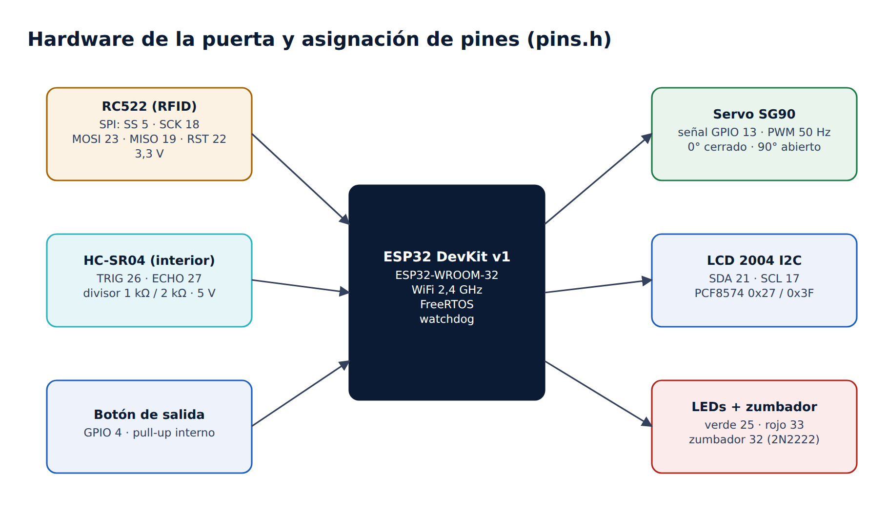

| Componente | Conexión (de `include/pins.h`) | Observaciones |
|---|---|---|
| RC522 | SS 5, SCK 18, MOSI 23, MISO 19, RST 22, 3,3 V | Nunca a 5 V |
| HC-SR04 | TRIG 26, ECHO 27 | Divisor 1 kΩ / 2 kΩ en ECHO |
| Servo SG90 | Señal 13 (PWM 50 Hz, 500–2400 µs) | Condensador de 470 µF; 0° cerrado, 90° abierto |
| LCD 2004 I2C (PCF8574) | SDA 21, SCL 17 | Dirección 0x27/0x3F autodetectada |
| Pulsador | GPIO 4 a GND (pull-up interno) | En el árbol de trabajo: botón de salida interior |
| LED verde / rojo | GPIO 25 / 33 con 220 Ω | — |
| Zumbador | GPIO 32 vía 2N2222 | — |

### 8.6 Dependencias y despliegue

La imagen Docker (`python:3.12-slim-bookworm`) se ejecuta con el usuario sin privilegios `dcg`, sistema de archivos de solo lectura y un *healthcheck* sobre `/api/v1/health`. Los datos (BD, claves de desarrollo, modelos) viven en el volumen `dc-guardian-data`. La webcam no se expone al contenedor y el ESP32 se programa aparte con PlatformIO. Restricción documentada: una réplica y un *worker*, porque el hub de WebSocket, el limitador de intentos y las puertas virtuales viven en memoria.

## 9. Metodología de desarrollo

El historial y la documentación permiten reconstruir el proceso:

1. **Diseño primero (F1).** `docs/FASE1_ARQUITECTURA.md` fija requisitos, arquitectura, modelo de datos, API, protocolo, riesgos y plan de fases, y se declara «fuente de verdad». Incluye decisiones pendientes que se resolvieron con el autor (p. ej., servo SG90).
2. **Desarrollo incremental por fases** con criterio de salida: F2 base (estructura, modelos, migraciones, autenticación), F3 dominio, F4 visión, F5 motor de acceso y gateway, F6 frontend, F7 firmware, F8 integración y F9 cierre (LCD, Docker, documentación).
3. **Desarrollo asistido por agentes especializados.** `.claude/agents/` define siete subagentes (hardware, vision, database, backend, frontend, security, integration), cada uno con archivos propios; los cambios que cruzan fronteras pasan por el de integración y el de seguridad revisa al cierre de cada fase.
4. **Revisiones de seguridad** con hallazgos clasificados (ALTA, MEDIA, BAJA) y una prueba de regresión por cada corrección (`tests/e2e/test_security_regressions.py`).
5. **Auditoría de cierre** (`docs/AUDITORIA.md`), que detectó, por ejemplo, que el frontend no se servía por falta de `index.html` y que faltaban páginas.
6. **Control de versiones.** El repositorio tiene 7 *commits* del 14 y 15 de noviembre de 2026 (backend, frontend, firmware, Docker, documentación, segunda red WiFi y `run.sh`). El historial es corto porque el directorio se convirtió en repositorio git al final (lo indica la auditoría), así que no refleja todo el proceso.

En el árbol de trabajo hay una iteración posterior **sin confirmar** (15-11-2026): botón de salida interior, alarma de intrusión, saludo personalizado en el LCD y sus pruebas.

## 10. Fuentes de datos

El proyecto **no usa conjuntos de datos externos, archivos CSV de entrada ni APIs de terceros**. Todos los datos los genera el propio sistema a partir de cuatro fuentes:

| Fuente | Tipo / formato | Datos relevantes | Adquisición | Frecuencia |
|---|---|---|---|---|
| Lector RC522 | UID hexadecimal (4 o 7 bytes) | `uid` | ESP32 → `POST /device/access/start` firmado | En cada pasada de tarjeta |
| Webcam del kiosco | 5 imágenes JPEG (multipart) | Fotogramas del rostro | Navegador (`getUserMedia`) → `POST /vision/verify` | En cada verificación; se procesan en memoria |
| Telemetría del ESP32 | JSON | `fw`, `state`, `door`, `present`, `distance_cm`, `rssi`, `uptime_s`, `free_heap`, `sensors{rfid, ultrasonic}` | `POST /device/heartbeat` y `POST /device/presence` | Latido cada 15 s; presencia al cambiar |
| Panel de administración | Formularios → JSON | Ingenieros, tarjetas, áreas, dispositivos, solicitudes | API REST con sesión JWT | Bajo demanda |
| Semilla de demostración | Script `scripts/seed.py` | 3 áreas, 3 ingenieros ficticios, 4 tarjetas, 1 dispositivo | Ejecución manual | Una vez |

### 10.1 Estructura de almacenamiento

| Tabla | Contenido | Campos relevantes |
|---|---|---|
| `engineers` | Registro 1: identidad | `engineer_id` (ENG-NNNN), nombre, departamento, cargo, correo institucional, estado |
| `face_embeddings` | Registro 1: biometría | `embedding_encrypted` (vector de 512 floats cifrado), `model_name`, `quality_score`, `is_primary` |
| `authorization_requests` | Registro 2 | ingeniero, tarjeta, área, motivo, `start_at`/`end_at`, estado, revisor, notas |
| `rfid_cards` | Tarjetas | `uid`, estado (`ACTIVA`, `BLOQUEADA`, `PERDIDA`, `BAJA`), ingeniero |
| `areas`, `devices` | Instalaciones | nivel de seguridad, `secret_encrypted`, umbral de presencia, `door_open_ms`, telemetría |
| `access_sessions` | Cada intento | sentido, estado, `reason_code`, `face_score`, distancias, marcas de tiempo |
| `alerts` | Alertas | tipo, severidad (`INFO`, `WARN`, `CRITICAL`), reconocimiento |
| `audit_log` | Auditoría | actor, acción, entidad, detalles, `correlation_id`, `prev_hash`, `hash` |
| `device_nonces` | Anti-*replay* | nonces usados por dispositivo |
| `admins` | Cuentas | usuario, hash bcrypt, rol |

### 10.2 Calidad y confiabilidad

- Los UID se normalizan y validan; el UID **solo identifica** y nunca basta para abrir.
- Las fechas se guardan siempre en UTC con zona horaria (`app.db.types.UTCDateTime`).
- Los mensajes del dispositivo se autentican, tienen límite de tamaño y se validan con listas blancas.
- Las imágenes pasan un control de calidad antes de generar un embedding.
- La telemetría del HC-SR04 se filtra en el firmware con mediana móvil e histéresis.
- La configuración comprueba su propia coherencia al arrancar (p. ej., `FACE_MIN_MATCHES ≤ FACE_FRAMES` y umbral de duplicados ≤ umbral de verificación) para no fallar en abierto.

## 11. Procesamiento de datos

No existe un proceso ETL ni analítico clásico. El «procesamiento» del sistema es la cadena de validación y transformación que convierte cada dato de entrada en una decisión y en un registro.

| Etapa | Mensajes del ESP32 | Imágenes faciales | Datos administrativos |
|---|---|---|---|
| Extracción | Petición HTTP con cabeceras `X-Device-Id`, `X-Timestamp`, `X-Nonce`, `X-Signature` | Multipart con 5 JPEG | JSON de formularios |
| Validación | Firma HMAC en tiempo constante, reloj ±30 s, *nonce* no usado, cuerpo ≤ 4 KiB, sin parámetros duplicados | Tamaño máximo 6 MiB, número exacto de fotogramas | Esquemas Pydantic, dominio de correo opcional, solapamiento de solicitudes, máximo 90 días de antelación |
| Limpieza | Rechazo de campos fuera de rango (`poll_ms` 300–2000, `open_ms` 1000–30000) | Un solo rostro, tamaño ≥ 80 px, nitidez (varianza del laplaciano ≥ 40), pose (yaw ≤ 0,35) y confianza de detección ≥ 0,60 | Normalización de usuario y UID |
| Transformación | Distancia → presencia (umbral del dispositivo) | Imagen → embedding normalizado L2 de 512 dimensiones | Duración → `end_at`; fechas a UTC |
| Integración | Búsqueda tarjeta → ingeniero → solicitud vigente | Comparación coseno con las muestras del titular | Vinculación tarjeta–ingeniero–área |
| Procesamiento | Máquina de estados de la sesión | ≥ 0,45 en ≥ 3 de 5 fotogramas y *liveness* básica | Máquina de estados de la solicitud |
| Almacenamiento | `access_sessions`, `device_nonces`, telemetría en `devices` | Solo el embedding cifrado con Fernet; las imágenes se descartan | Tablas de dominio |
| Preparación para visualización | Evento WebSocket tras el *commit*; estadísticas de `/stats/dashboard` | Puntuación facial en la sesión | Auditoría encadenada y alertas |

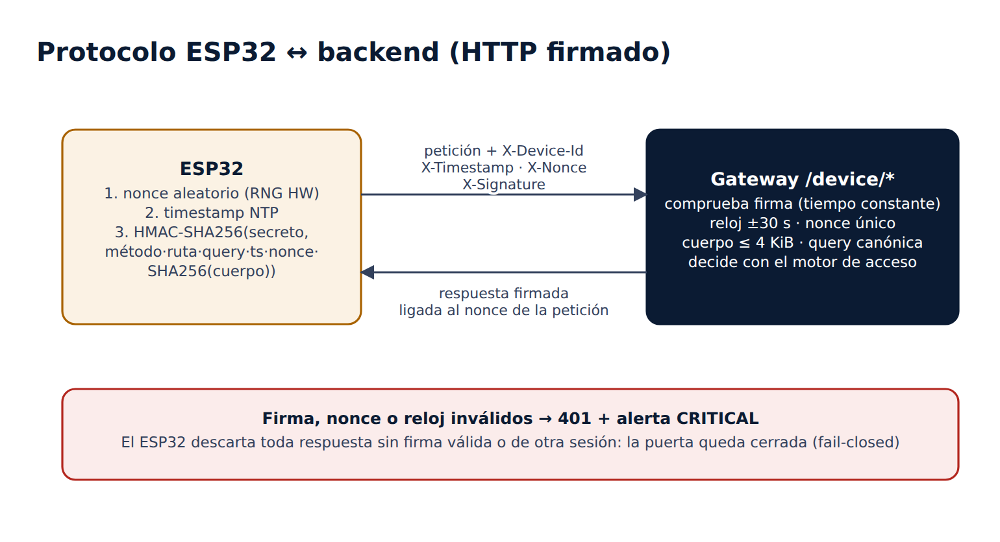

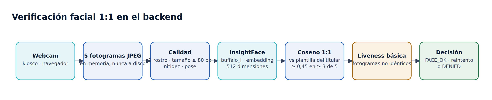

**Auditoría encadenada.** Cada entrada de `audit_log` se serializa de forma canónica (JSON ordenado) y su hash es `HMAC-SHA256(clave_derivada, hash_anterior + entrada)`, partiendo de un hash génesis de 64 ceros. `GET /audit/verify` recalcula la cadena completa; cualquier modificación o borrado rompe la verificación.

## 12. Funcionalidades

| Nombre | Objetivo | Funcionamiento | Entradas | Salidas | Componentes |
|---|---|---|---|---|---|
| Registro de ingenieros | Mantener la identidad (Registro 1) | Genera `ENG-NNNN`; estados y borrado de datos personales con confirmación | Datos personales | Ficha del ingeniero, auditoría | `services/engineers.py`, `pages/engineers*.html` |
| Registro facial | Asociar biometría al ingeniero | 3–5 imágenes, control de calidad, consistencia entre muestras (≥ 0,40) y detección de duplicados frente a otros ingenieros (≥ 0,45) | Imágenes de la webcam | Embeddings cifrados | `services/biometrics.py`, `vision/` |
| Tarjetas RFID | Gestionar credenciales físicas | Alta, vinculación a un ingeniero activo, bloqueo, pérdida, baja, desbloqueo | UID | Estado de la tarjeta | `services/cards.py`, `pages/cards.html` |
| Áreas y dispositivos | Modelar la instalación | CRUD de áreas; alta de dispositivo con secreto mostrado una vez; rotación del secreto | Código, área, umbrales | Secreto HMAC (una vez) | `services/facility.py` |
| Solicitudes de autorización | Conceder permisos temporales (Registro 2) | `PENDIENTE` → `APROBADA`/`RECHAZADA` → `FINALIZADA`/`EXPIRADA`/`REVOCADA`; sin autoaprobación; suspender revoca | Ingeniero, tarjeta, área, motivo, ventana | Solicitud y su estado | `services/requests.py`, `pages/requests.html` |
| Acceso multifactor (entrada) | Abrir solo con todos los factores | Ver §8.3 | UID, 5 fotogramas | `GRANTED` firmado o `DENIED` con motivo | `services/access_engine.py`, `api/v1/device_gateway.py`, `api/v1/kiosk.py` |
| Salida | Que nadie quede atrapado | Segunda pasada con rostro sin exigir autorización; o botón interior si alguien está dentro (`NOBODY_INSIDE` si no) | UID + rostro, o botón | Apertura y `access.exit` | `access_engine.exit_button` |
| Bloqueo por fallos | Frenar ataques por fuerza bruta | 3 denegaciones en 5 min bloquean la tarjeta 10 min | Denegaciones | Alerta `REPEATED_FAILURES` | `access_engine._record_failure` |
| Alarma de intrusión | Detectar presencia no autorizada en la sala | Si el HC-SR04 interior detecta a alguien sin nadie autorizado dentro ni puerta en uso: alarma 20 s | Presencia | Alerta `INTRUSION` CRITICAL, LED rojo y zumbador | `access_engine.presence`, firmware |
| Alertas | Avisar de anomalías | Tarjeta desconocida, rostro no coincidente, ingeniero inactivo, sensor caído, dispositivo sin conexión, firma inválida… | Eventos | Alertas con severidad, atención | `services/alerts.py`, `pages/alerts.html` |
| Auditoría | Trazabilidad verificable | Cadena de hashes HMAC; filtros por acción y `correlation_id` | Toda acción relevante | Registro y verificación | `services/audit.py`, `pages/audit.html` |
| Panel en tiempo real | Supervisión | KPIs, hardware, ingenieros dentro, denegaciones por motivo, eventos | WebSocket, `/stats/dashboard` | Interfaz actualizada | `pages/dashboard.html`, `ws/` |
| Cierre de emergencia | Cerrar remotamente | Comando `EMERGENCY_CLOSE` entregado en el siguiente latido (no existe un comando de apertura) | Acción del administrador | Puerta cerrada | `request_emergency_close` |
| Simulador | Probar sin hardware | ESP32 virtual que firma peticiones reales; rostros sintéticos (`match`, `other`, `stranger`) | Botones del panel o CLI | Mismo flujo que el hardware | `app/sim/`, `simulator/esp32_sim.py` |
| LCD 2004 | Informar en la puerta | Pantallas: esperando tarjeta, RFID, verificando, rostro, concedido (con saludo), denegado con motivo, puerta, alarma, errores | Estado del controlador | Texto en 4×20 | `lcd_view.*`, `lcd_esp32.*` |

## 13. Interfaz y experiencia de usuario

La interfaz es web, en español, sin instalación ni compilación. Se compone de 12 páginas con un menú común: inicio de sesión, panel, ingenieros (lista, alta y ficha), tarjetas, solicitudes, accesos, alertas, auditoría, simulador y kiosco. Usa variables de diseño (`tokens.css`) con modo oscuro automático, insignias de estado en color y tablas con filtros y paginación («Cargar más»).

Las capturas siguientes son **reales**: se tomaron el 15-11-2026 con Chromium sin interfaz (1440 × 900, escala 1,5) sobre el sistema ejecutándose en modo simulación, con una base de datos aislada, los datos ficticios de la semilla y un escenario de demostración (2 entradas, 1 salida y 3 denegaciones).

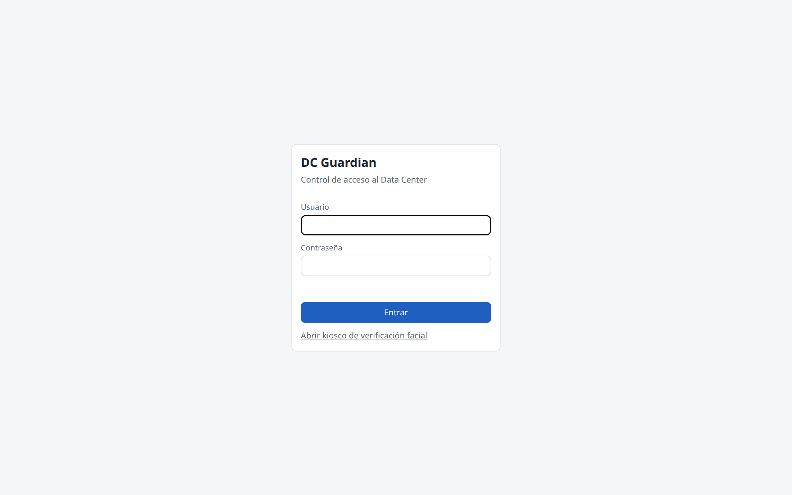

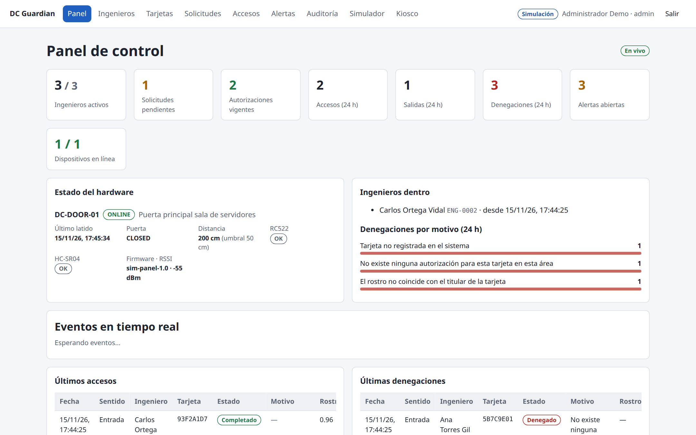

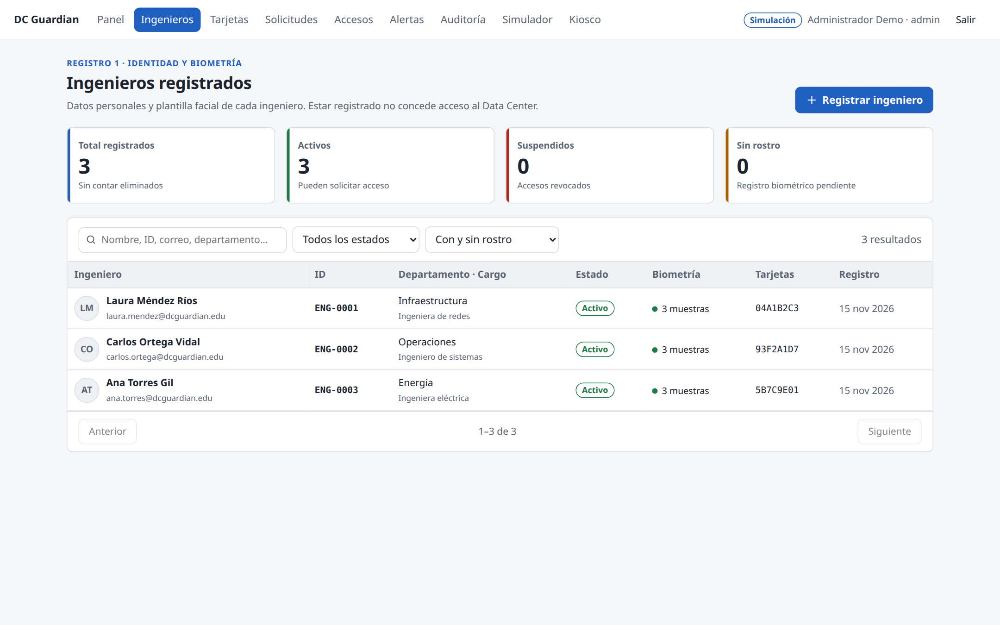

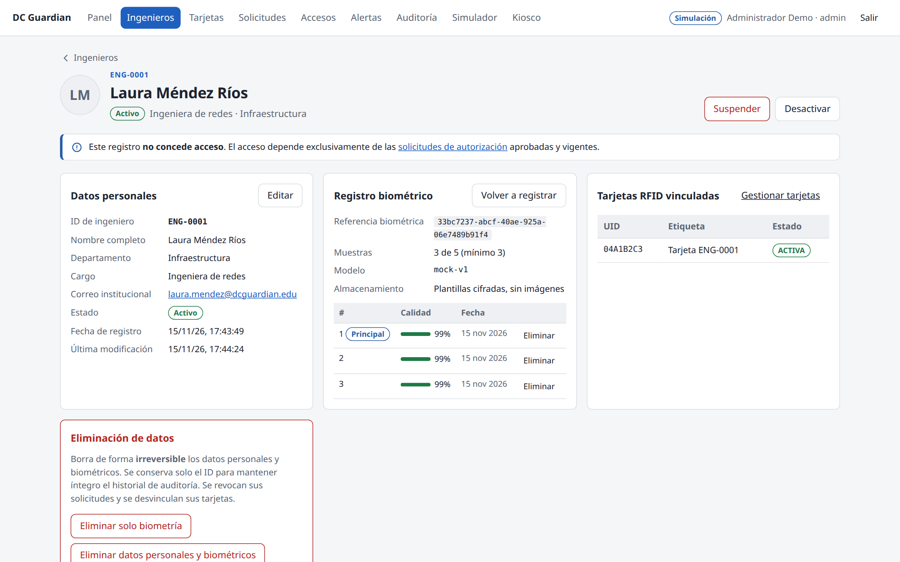

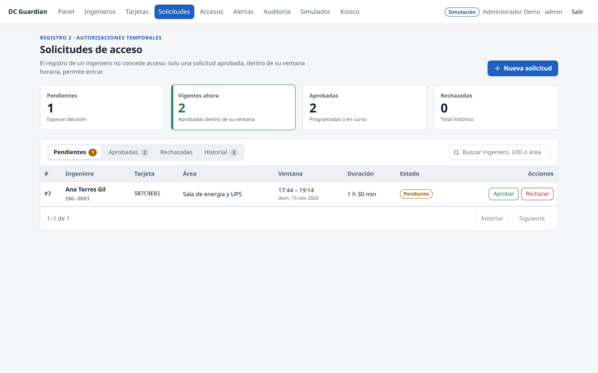

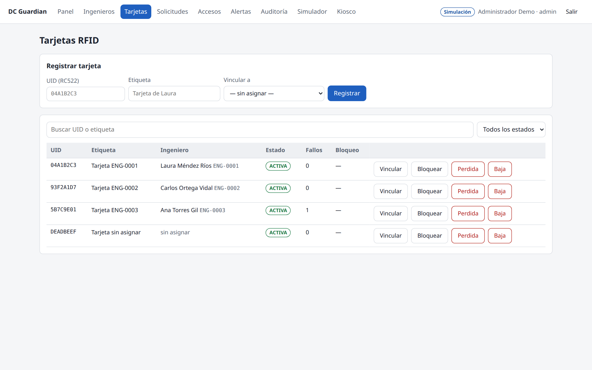

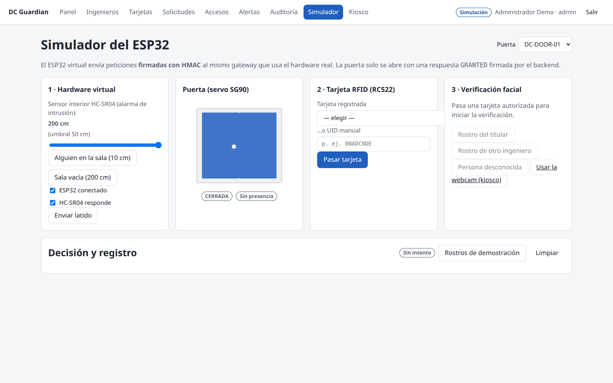

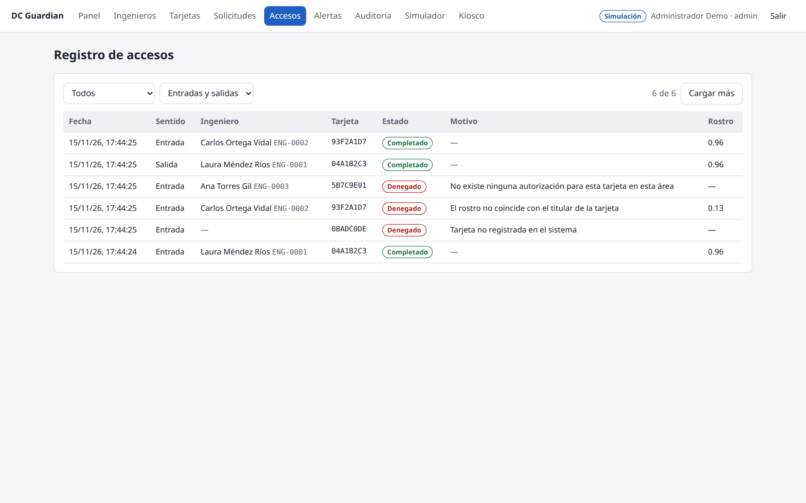

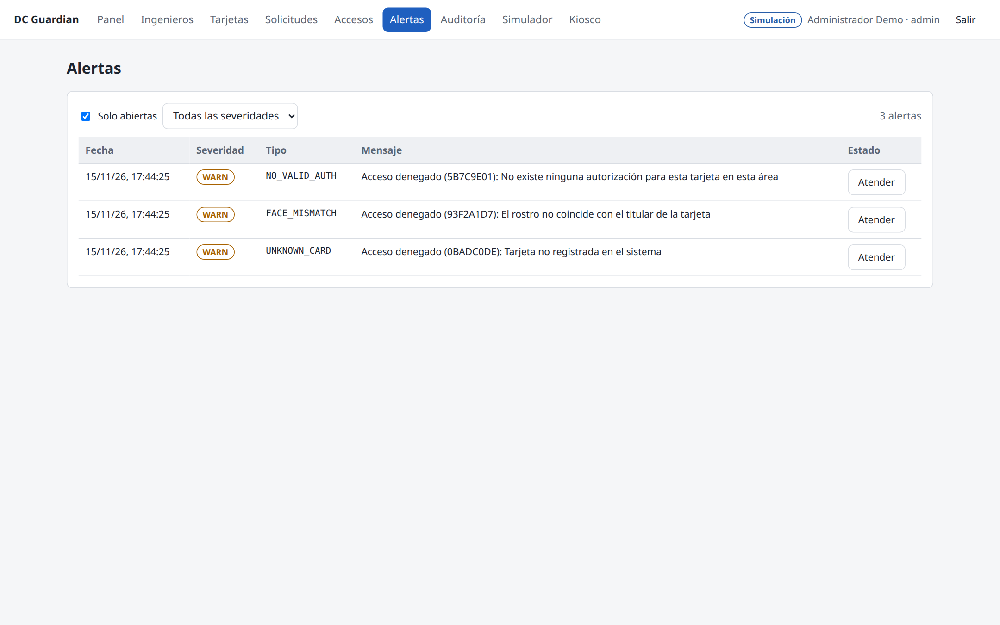

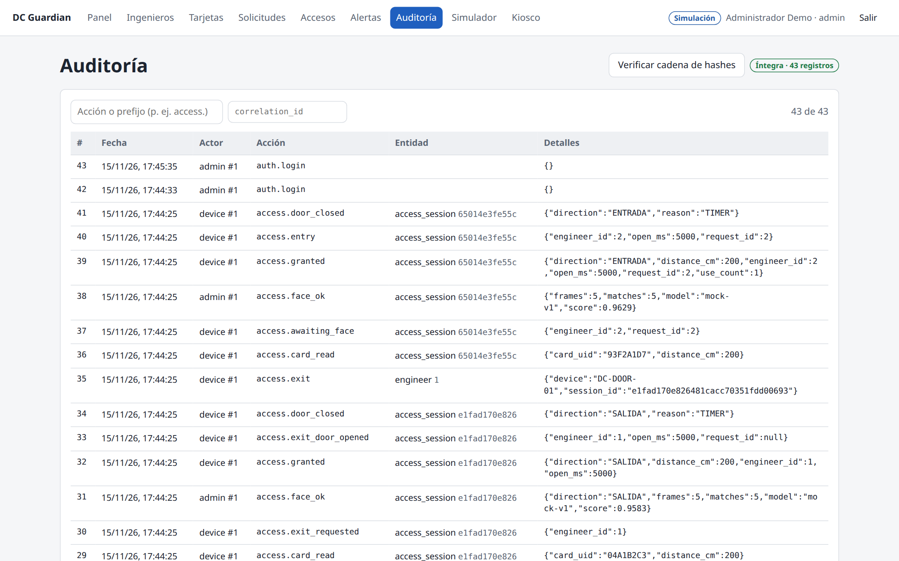

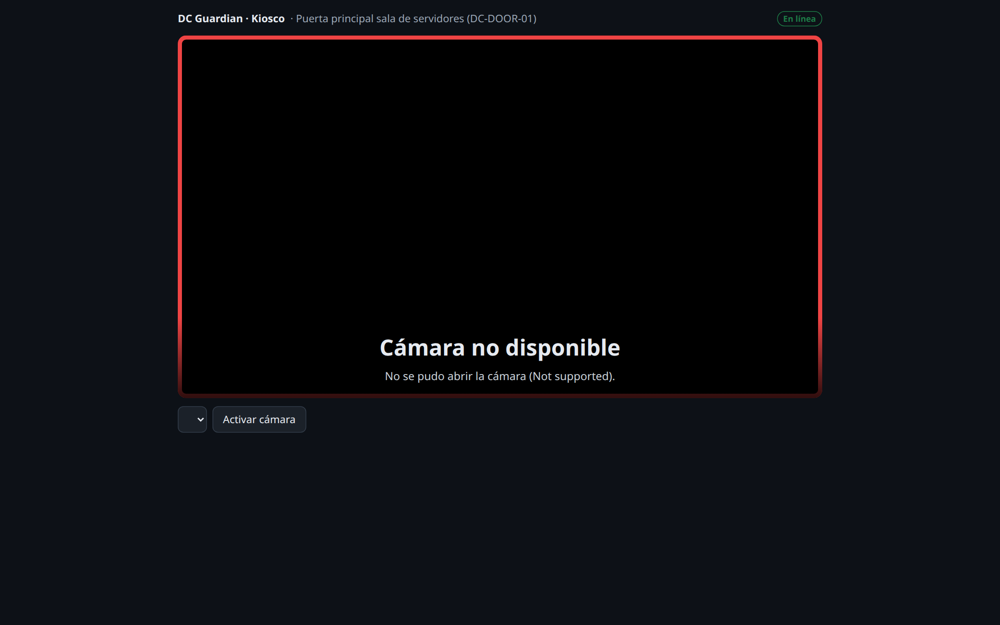

**Interacción principal.** El administrador registra ingenieros y rostros, crea y aprueba solicitudes y supervisa el panel, que se actualiza solo. En la puerta, el ingeniero no usa la interfaz: pasa la tarjeta y mira al kiosco, que pasa a modo de captura al recibir el evento `access.awaiting_face`. El LCD de la puerta guía cada paso.

## 14. Resultados

### 14.1 Resultados de pruebas (ejecutadas para este reporte)

| Suite | Comando | Resultado |
|---|---|---|
| Backend completo | `cd backend && .venv/bin/pytest` | **222 aprobadas**, 0 fallidas |
| Firmware nativo (Unity) | `pio test -e native` | **86 aprobadas** en 7 suites (5,3 s) |
| Firmware ↔ gateway | `pytest test/integration` | **13 aprobadas** (83,9 s) |
| **Total** | | **321 aprobadas** |

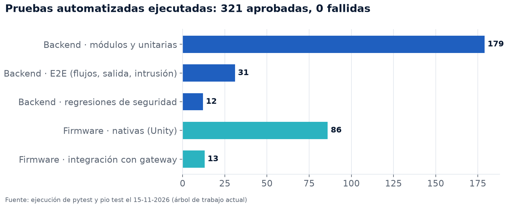

### 14.2 Resultados reales con hardware (base de datos local)

La base de datos local `data/dcguardian.db` registra una sesión de uso del 15-11-2026 (21:01–22:42 UTC). Se considera hardware real porque los latidos llevan el firmware `1.0.0` (el del ESP32; el simulador usa `sim-1.0.0` o `sim-panel-1.0`), RSSI −64 dBm y memoria libre de 231 956 bytes, valores que el simulador no produce, y porque las verificaciones usan el modelo `buffalo_l`. El archivo `data/tarjetas_leidas.txt` registra además lecturas de tarjetas físicas por `DC-DOOR-01`. **No hay documentación formal de esta prueba**; los datos se presentan agregados y sin datos personales.

| Indicador | Valor |
|---|---|
| Sesiones de acceso | 39 (11 concedidas y cerradas, 28 denegadas) |
| Aperturas | 11: 6 entradas con rostro y 5 salidas (2 con rostro, 3 con el botón interior) |
| Verificaciones faciales | 8 aceptadas (similitud 0,61–0,84, 4–5 de 5 fotogramas) y 1 rechazada (0,29) |
| Reintentos por rostro no detectado | 5 |
| Tiempo decisión → puerta abierta | 0,7–1,2 s |
| Tiempo tarjeta → decisión (con rostro) | 6,2–12,7 s (incluye el tiempo de la persona ante la cámara y los reintentos) |
| Tiempo botón de salida → decisión | 0,4–1,5 s |
| Puerta abierta | 5,1–7,0 s (configurado: 5 000 ms) |
| Alertas | 38: 12 tarjeta desconocida, 7 dispositivo sin conexión, 5 fallo de sensor, 4 intrusión (CRITICAL), 2 tarjeta bloqueada, 3 sin autorización, 2 presencia perdida, 1 fallo de autenticación del dispositivo, 1 rostro no coincidente, 1 fallos repetidos |
| Auditoría | 349 entradas (242 de dispositivo, 82 de administrador, 25 del sistema) |

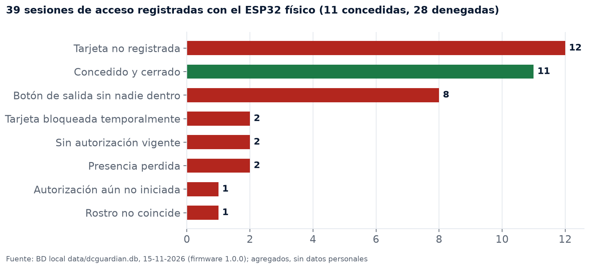

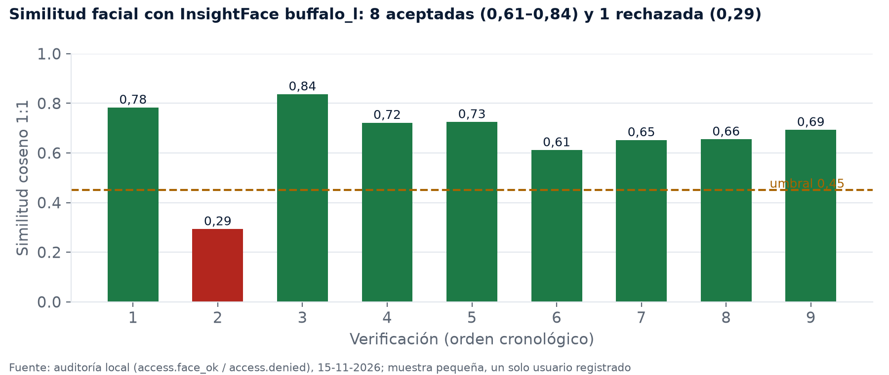

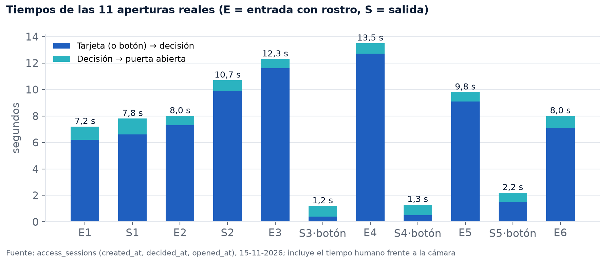

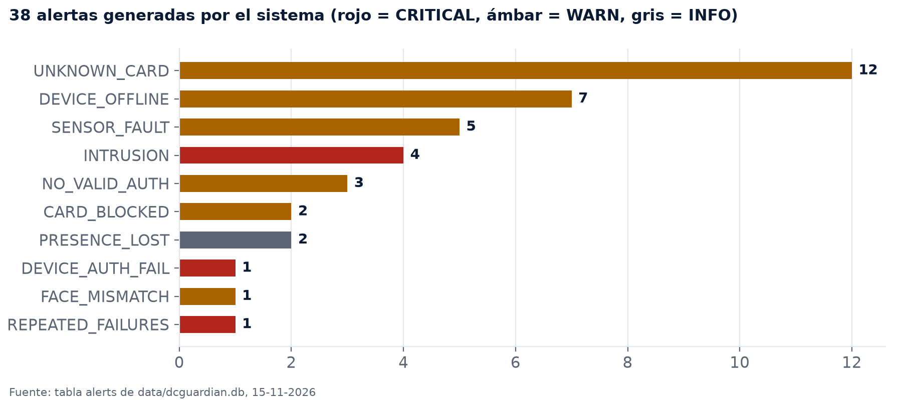

Los datos originales agregados están en `graficos/datos_sesiones_acceso_reales.csv`, `graficos/datos_alertas_reales.csv` y `graficos/datos_puntuaciones_faciales_reales.csv`.

**Interpretación.** El flujo completo funcionó con el hardware y el modelo reales, y las denegaciones observadas son las esperadas (tarjetas no registradas, botón sin nadie dentro, bloqueo por fallos). Las similitudes aceptadas quedan muy por encima del umbral de 0,45. Sin embargo, la muestra es de **un solo usuario registrado** y un único rechazo, de origen no documentado: **no permite estimar tasas de falsa aceptación ni de falso rechazo**. El objetivo de diseño de «decisión completa < 5 s» **no se cumple** en las entradas con rostro si se mide desde la tarjeta (6–13 s), aunque esa medida incluye el tiempo humano.

### 14.3 Datos de demostración

Las capturas de la sección 13 y el escenario usado para tomarlas son **datos de demostración**: personas, áreas y tarjetas ficticias de la semilla y rostros sintéticos del proveedor `mock` (similitud 0,96 en coincidencias y 0,13 con el rostro de otro ingeniero). No deben interpretarse como rendimiento del modelo real.

### 14.4 Tamaño del proyecto

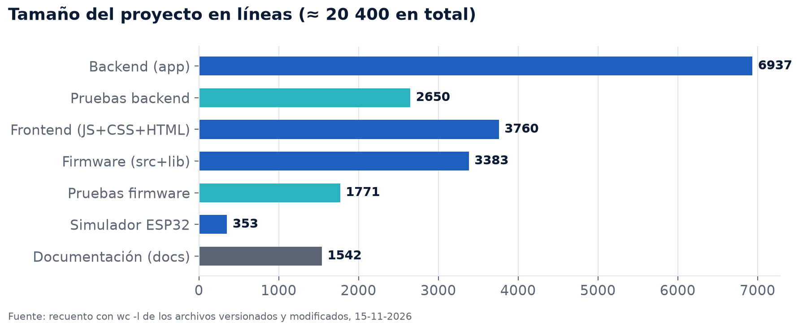

### 14.5 Aspectos todavía no evaluados

- Precisión del reconocimiento facial con varias personas (FAR/FRR) y calibración del umbral.
- Resistencia a ataques de presentación (fotografía impresa, pantalla, máscara).
- Kiosco con webcam en una prueba documentada (la BD local sugiere que se usó, pero no hay registro formal).
- Funcionamiento físico del LCD 2004, del botón de salida y de la alarma de intrusión más allá de los eventos registrados.
- Rendimiento y concurrencia con varias puertas.
- Despliegue con HTTPS y kiosco en otro equipo.

## 15. Pruebas y validación

### 15.1 Pruebas existentes

| Archivo | Pruebas | Qué cubren |
|---|---|---|
| `tests/test_biometrics.py` | 39 | Calidad, registro facial, duplicados, verificación 1:1, liveness |
| `tests/test_requests.py` · `test_requests_module.py` | 22 · 12 | Máquina de estados de solicitudes, solapamientos, autoaprobación |
| `tests/test_audit_and_security.py` | 21 | Cadena de auditoría, HMAC, cifrado |
| `tests/test_engineers.py` | 21 | Alta, estados, borrado de datos personales |
| `tests/test_auth.py` | 20 | Inicio de sesión, bloqueo, JWT, roles |
| `tests/test_models.py` · `test_cards_facility.py` · `test_review_f3.py` | 15 · 12 · 14 | Modelos, tarjetas, áreas, dispositivos, correcciones de la revisión F3 |
| `tests/test_migrations.py` · `test_seed.py` | 2 · 1 | Migraciones Alembic y semilla |
| `tests/e2e/test_access_flows.py` | 22 | Flujos completos de acceso y denegación |
| `tests/e2e/test_security_regressions.py` | 12 | Regresiones de la revisión de seguridad |
| `tests/e2e/test_exit_button_and_lcd.py` (sin confirmar en git) | 4 | Botón de salida y saludo del LCD |
| `tests/e2e/test_intrusion_alarm.py` (sin confirmar en git) | 5 | Alarma de intrusión |
| Firmware `test_controller` · `test_lcd` · `test_backend_client` · `test_signing` · `test_presence` · `test_protocol` · `test_door` | 26 · 16 · 13 · 9 · 8 · 8 · 6 | Lógica del firmware en PC (Unity) |
| Firmware `test/integration` | 13 | Núcleo C++ real contra el gateway por HTTP, incluido un vector de firma compartido |

### 15.2 Casos de prueba destacados (de `docs/pruebas-integracion.md` y del código)

| Escenario | Resultado esperado y verificado por prueba |
|---|---|
| Flujo completo de 18 pasos | Sin solicitud → `NO_VALID_AUTH`; con solicitud aprobada → `AWAITING_FACE → FACE_OK → GRANTED` → abre → cierra; auditoría en orden; segunda pasada = salida |
| Tarjeta desconocida | `UNKNOWN_CARD` y alerta WARN |
| Rostro de otra persona / misma foto 5 veces | `FACE_MISMATCH` / `LIVENESS_FAILED` |
| Ingeniero suspendido | Solicitud revocada; intento → `ENGINEER_INACTIVE` y alerta CRITICAL |
| Autorización expirada, pendiente o revocada | `AUTH_EXPIRED`, `REQUEST_PENDING`, `AUTH_REVOKED` (también entre rostro y apertura) |
| ESP32 sin latido > 45 s | `OFFLINE`, alerta `DEVICE_OFFLINE` y evento WebSocket |
| Firma falsa, *nonce* repetido, reloj desfasado | 401 firmado y alertas `DEVICE_AUTH_FAIL`, `DEVICE_REPLAY`, `DEVICE_CLOCK_SKEW`; un `GRANTED` manipulado no abre |
| 3 fallos en 5 min | `REPEATED_FAILURES` y bloqueo de 10 min |

### 15.3 Errores identificados

- La revisión de seguridad de cierre registró 1 hallazgo ALTO (salida sin rostro con un solo lector), 5 MEDIOS y 9 BAJOS; los corregidos tienen prueba de regresión y 4 se aceptaron documentados (B2, B3, B7 y la rotación del token derivado del kiosco).
- La auditoría de cierre detectó que el frontend no se servía y que el menú enlazaba 8 páginas inexistentes; se corrigió creando las páginas.
- **Inconsistencia de documentación detectada en este análisis:** el README (§1, §2, §11) todavía describe el HC-SR04 como sensor de presencia en la puerta y el pulsador como cierre de emergencia, mientras que el código y `docs/protocolo-esp32.md` del árbol de trabajo lo describen como sensor de intrusión interior y botón de salida. El README también indica 210 pruebas de backend y 75 del firmware, frente a las 222 y 86 obtenidas hoy.
- **Desfase con el remoto:** la rama `main` de GitHub está en el *commit* `68afbe1`; los dos *commits* posteriores y los cambios del árbol de trabajo no están publicados.

### 15.4 Lo que no se ejecutó

No se compiló el firmware para la placa (`pio run -e esp32dev`) ni se ejecutó en hardware durante la elaboración de este reporte; tampoco se construyó la imagen Docker. Esas verificaciones se citan desde la documentación del proyecto.

## 16. Seguridad y consideraciones técnicas

| Aspecto | Implementación | Riesgo residual |
|---|---|---|
| Credenciales de administrador | bcrypt; bloqueo tras 5 fallos (15 min); límite de 10 intentos/min por IP; JWT HS256 en cookie `HttpOnly`, `SameSite=Strict`, 60 min | Sin segundo factor para el administrador |
| Variables de entorno | Prefijo `DCG_`; en desarrollo las claves se generan y guardan en `data/.dev_keys.json` (permisos 600); en producción `DCG_JWT_SECRET` y `DCG_MASTER_KEY` son obligatorias (≥ 43 caracteres) y se prohíbe la simulación y el proveedor facial *mock* | Configuración incorrecta en entornos no `prod` |
| Secretos de dispositivo | Cifrados con Fernet en la BD; se muestran una sola vez; rotación disponible | En el ESP32 el secreto está en flash sin cifrar (`dcg_config.h`, ignorado por git) |
| Protocolo del ESP32 | HMAC-SHA256 en peticiones y respuestas, *nonce* de 16 bytes del RNG hardware, reloj NTP ±30 s, respuesta ligada al *nonce*, sin comando de apertura remota | HTTP sin TLS por defecto: el tráfico se puede leer (no falsificar) |
| Datos biométricos | Solo embeddings, cifrados; fotogramas en memoria; borrado de datos personales | *Liveness* básica; umbral sin calibrar |
| Integridad de registros | Auditoría encadenada con HMAC y verificación desde la UI | Quien tenga la clave maestra y la BD podría recalcular la cadena |
| Kiosco | Token de kiosco (≥ 43 caracteres) enviado en el primer mensaje del WebSocket; proyección mínima de datos | `getUserMedia` exige `localhost` o HTTPS |
| Superficie web | Validación de `?next=` contra redirección abierta, escape en la UI, límite de cuerpo de 4 KiB en el gateway | — |
| Repositorio | `data/`, `.env` y `dcg_config.h` en `.gitignore` y `.dockerignore` | — |
| Dependencias | Versiones fijadas en `uv.lock` y `requirements.lock.txt`; imagen sin root y de solo lectura | `insightface` arrastra `opencv-python` con GUI además de la variante *headless* (señalado en la auditoría) |

**Recomendaciones:** HTTPS con proxy inverso y CA fijada en el firmware; cifrado de flash o almacenamiento seguro del secreto en el ESP32; segundo factor para administradores; calibración del umbral facial y *liveness* activa; copia de seguridad y rotación periódica de la clave maestra; análisis automático de vulnerabilidades de dependencias en CI (no existe hoy).

## 17. Limitaciones

1. **Reconocimiento facial no calibrado** con una población real; prueba de vida básica.
2. **HTTP sin TLS** en la red local por defecto.
3. **Secreto del ESP32** sin cifrar en la flash.
4. **Escalabilidad limitada:** una instancia, un *worker* y SQLite.
5. **Sin sensor de puerta:** el cierre se infiere por temporizador.
6. **Kiosco** solo en `localhost` o con HTTPS.
7. **Dependencia de la red para salir:** sin conexión, el botón de salida no abre (diseño *fail-closed*); se requiere un desbloqueo mecánico.
8. **Documentación parcialmente desactualizada** respecto al árbol de trabajo y cambios sin confirmar en git.
9. **Pruebas con hardware no documentadas formalmente**.

## 18. Trabajo futuro

| Mejora | Viabilidad técnica |
|---|---|
| Confirmar en git los cambios del árbol de trabajo y actualizar el README | Inmediata |
| Documentar la prueba con hardware (procedimiento, fotos del montaje, resultados) | Inmediata |
| Calibrar el umbral con un conjunto de rostros de varias personas y medir FAR/FRR | Media; requiere consentimiento y datos |
| *Liveness* activa (parpadeo, giro) o cámara con profundidad | Media |
| HTTPS con Nginx/Caddy y CA fijada en el firmware | Alta; ya documentado como opcional |
| Almacenamiento seguro del secreto (cifrado de flash / NVS cifrado del ESP32) | Media |
| PostgreSQL y bus de eventos para varias instancias | Media; SQLAlchemy facilita el cambio |
| Sensor de puerta (*reed switch*) para detectar puerta forzada o abierta | Alta |
| Portal del ingeniero para solicitar accesos | Alta |
| Integración continua con las tres suites de pruebas | Alta |

## 19. Conclusiones

DC Guardian cumple su objetivo general como prototipo académico: implementa un control de acceso multifactor completo, en el que ni la tarjeta, ni el rostro, ni el registro por sí solos abren la puerta, y en el que el dispositivo nunca decide. Sus aportaciones más sólidas son la separación entre identidad (Registro 1) y permiso (Registro 2), el protocolo firmado en ambos sentidos con protección contra reinyección, la auditoría encadenada verificable y una base de 321 pruebas automatizadas que pasan.

Los registros locales muestran que el sistema funcionó con el ESP32 y el modelo facial reales, con aperturas en torno a un segundo tras la decisión y denegaciones coherentes. Al mismo tiempo, el proyecto declara con honestidad sus límites —umbral facial sin calibrar, *liveness* básica, tráfico sin TLS— que lo hacen inadecuado para un uso real sin más trabajo. Como base didáctica y prueba de concepto, es un sistema coherente, bien documentado y verificable.

## 20. Referencias

**Documentación del propio proyecto**

- `README.md`, `SECURITY.md`, `CONTRIBUTING.md`, `LICENSE`
- `docs/FASE1_ARQUITECTURA.md` (diseño, fuente de verdad), `docs/architecture.md`, `docs/api.md`, `docs/protocolo-esp32.md`, `docs/hardware.md`, `docs/cableado.md`, `docs/installation.md`, `docs/pruebas-integracion.md`, `docs/AUDITORIA.md`
- `firmware/esp32-door/README.md`
- Repositorio: https://github.com/santymontes234-a11y/dc-guardian

**Documentación oficial de las tecnologías**

- FastAPI — https://fastapi.tiangolo.com/
- SQLAlchemy — https://docs.sqlalchemy.org/ · Alembic — https://alembic.sqlalchemy.org/
- Pydantic — https://docs.pydantic.dev/
- SQLite (WAL) — https://www.sqlite.org/wal.html
- InsightFace — https://github.com/deepinsight/insightface
- ONNX Runtime — https://onnxruntime.ai/
- OpenCV — https://docs.opencv.org/
- cryptography (Fernet) — https://cryptography.io/en/latest/fernet/
- RFC 2104, HMAC — https://www.rfc-editor.org/rfc/rfc2104
- RFC 7519, JSON Web Token — https://www.rfc-editor.org/rfc/rfc7519
- MDN, `getUserMedia` — https://developer.mozilla.org/docs/Web/API/MediaDevices/getUserMedia
- ESP-IDF / ESP32 — https://docs.espressif.com/projects/esp-idf/
- Arduino-ESP32 — https://docs.espressif.com/projects/arduino-esp32/
- PlatformIO — https://docs.platformio.org/
- Docker Compose — https://docs.docker.com/compose/
- pytest — https://docs.pytest.org/ · Unity — https://www.throwtheswitch.org/unity

**Herramientas usadas para elaborar estos entregables:** pptxgenjs, python-pptx, docx (npm), marked, matplotlib, Playwright + Chromium, LibreOffice y Poppler.

## Anexo A. Material generado

| Carpeta | Contenido |
|---|---|
| `capturas/` | 11 capturas reales de la interfaz (PNG, 2160 × 1350) |
| `diagramas/` | 7 diagramas técnicos (PNG) |
| `graficos/` | 6 gráficos (PNG) y 3 CSV con los datos agregados reales |
