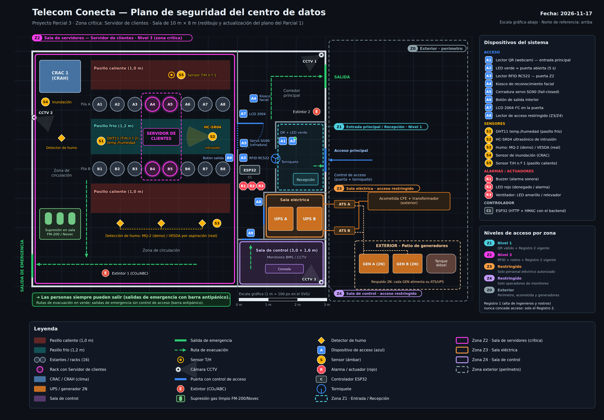
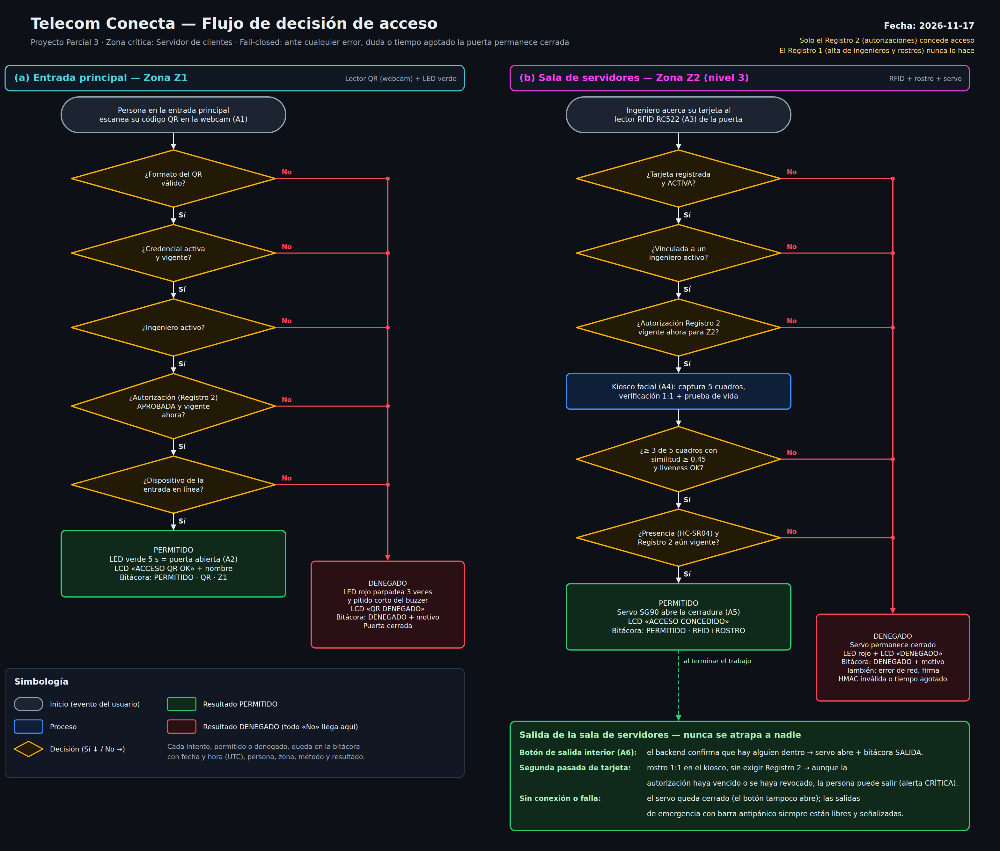
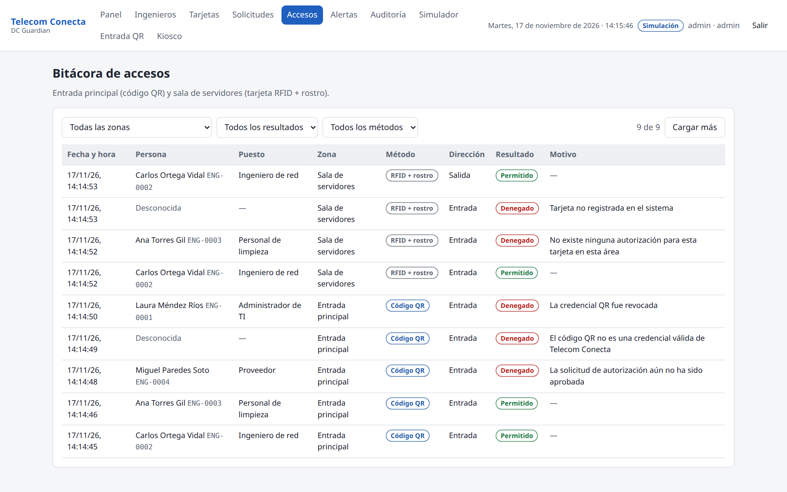
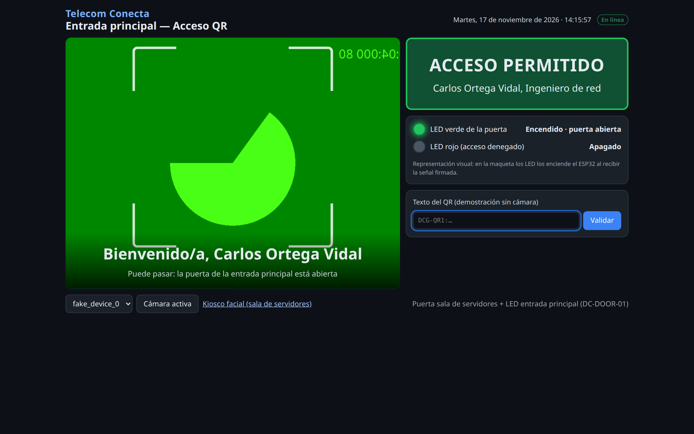
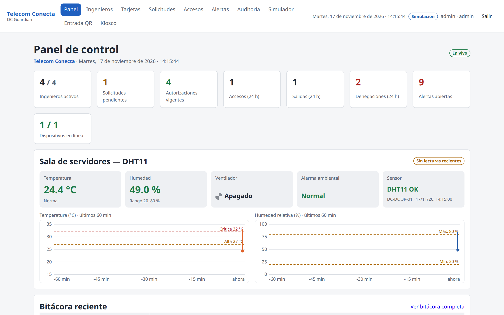
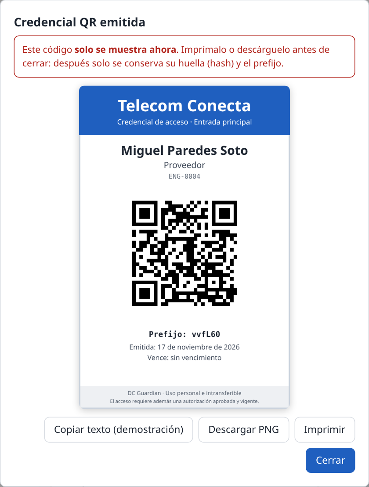
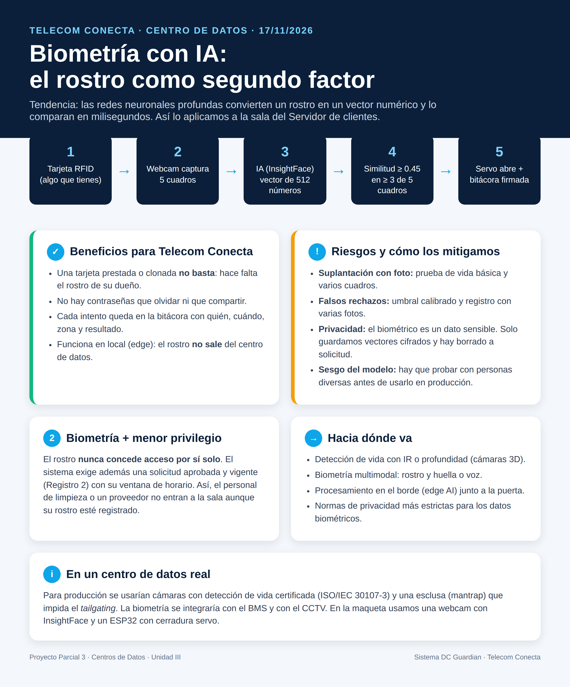

# Proyecto Parcial 3 — Maqueta segura: control de acceso y sensores

| Campo | Dato |
|---|---|
| Empresa (escenario 8) | **Telecom Conecta** |
| Zona crítica | Servidor de clientes |
| Equipo | [Nombre del equipo — POR COMPLETAR] |
| Integrantes y roles | [Integrante 1] — Arquitecto y documentación · [Integrante 2] — Control de acceso · [Integrante 3] — Sensores y alertas · [Integrante 4] — Maqueta y demostración |
| Materia | Centros de Datos — Unidad III (semanas 13 a 15) |
| Sistema | DC Guardian (control de acceso ESP32 + FastAPI + reconocimiento facial) |
| Fecha | 17 de noviembre de 2026 |

## Fotos de la maqueta

> **Pendiente de completar por el equipo.** Insertar aquí 2 o 3 fotos de la maqueta física (vista frontal, vista superior y detalle de la entrada con el ESP32). Las fotos deben mostrar el nombre «Telecom Conecta» y la fecha. Los nombres del equipo y de los integrantes tampoco estaban disponibles al generar este documento.

## 1. Resumen

Telecom Conecta es una empresa de telecomunicaciones. Su centro de datos guarda el **Servidor de clientes**: datos de abonados, contratos, facturación y CDR. Partimos de la maqueta del Proyecto Parcial 1 (sala de 10 × 8 m con pasillos frío y caliente, 16 racks, UPS y generadores 2N, CRAC y supresión con gas limpio). En este parcial le añadimos:

- **Dos zonas de acceso controlado con tres métodos del catálogo.**
  - Entrada principal: **código QR**.
  - Sala de servidores: **tarjeta RFID + reconocimiento facial**.
- **Sensores reales**, todos conectados al ESP32:
  - **DHT11** (temperatura y humedad), como sensor ambiental.
  - **HC-SR04** dentro de la sala, como sensor de intrusión.
- **Acciones automáticas**: ventilador, buzzer, LED rojo y LED verde, mensajes en la pantalla LCD y alertas en el dashboard en tiempo real.
- **Bitácora**: registra quién o qué, cuándo, en qué zona y con qué resultado, y está protegida con una cadena de hashes HMAC.

Implementamos el **nivel funcional** (bonus) con hardware real:
- un lector de acceso real que permite o niega el paso y deja registro;
- un sensor real que dispara una acción real;
- un envío de las alertas a una pantalla (LCD 2004 y dashboard web).

## 2. Decisiones y justificación

| Decisión | Por qué |
|---|---|
| **QR en la entrada principal** | Es el método más barato y rápido de reemplazar. El pase se imprime o se lleva en el celular. Sirve para proveedores y para personal de limpieza, que rotan con frecuencia. El QR por sí solo no da acceso: el sistema comprueba que el ingeniero esté activo y que tenga una **autorización vigente** (Registro 2). Si se pierde un QR, se revoca y se emite otro al instante. |
| **RFID + reconocimiento facial en la sala de servidores** | La zona crítica pide dos factores: *algo que tienes* (la tarjeta) y *algo que eres* (el rostro). Una tarjeta clonada o prestada no basta, porque el rostro tiene que coincidir en al menos 3 de 5 cuadros (umbral 0.45) y pasar una prueba de vida básica. |
| **LED verde para la puerta principal** | Representa la apertura en la maqueta sin añadir un segundo motor. La cerradura física (servo SG90) se queda en la sala de servidores, que es la zona crítica. |
| **DHT11 en el pasillo frío** | El riesgo ambiental más probable en una sala de telecomunicaciones es el sobrecalentamiento, por una falla del CRAC o por más carga en los racks. Los umbrales siguen la recomendación de ASHRAE para la temperatura de entrada a los equipos, entre 18 y 27 °C. |
| **HC-SR04 dentro de la sala** | Detecta a una persona dentro de la sala cuando el sistema no tiene registrado a nadie autorizado adentro. Por ejemplo: alguien que entró detrás de otra persona (*tailgating*) o que forzó la puerta. |
| **Un solo ESP32** | Atiende las dos puertas y los dos sensores. Así se simplifica el cableado de la maqueta. El protocolo firmado con HMAC-SHA256 impide que alguien falsifique una orden de apertura. |

## 3. D1 — Diagrama actualizado

| Zona | Nivel | Control |
|---|---|---|
| Z1 Entrada principal / Recepción | 1 | Lector QR (webcam) y LED verde (puerta) / LED rojo (denegado) |
| Z2 Sala de servidores — Servidor de clientes | 3 (crítica) | RFID RC522, reconocimiento facial en el kiosco y cerradura servo SG90. Dentro: DHT11 y HC-SR04 |
| Z3 Sala eléctrica (UPS A/B, ATS) | 2 | Acceso restringido (representado) |
| Z4 Sala de control (BMS/CCTV) | 2 | Acceso restringido (representado) |

Las **salidas de emergencia** están señaladas en el plano y en la maqueta:
- tienen **barra antipánico** y no pasan por el control de acceso, así que siempre se puede salir;
- la salida por la puerta controlada (botón interior o segunda pasada de la tarjeta + rostro) nunca exige una autorización vigente;
- **limitación:** el botón interior necesita conexión con el backend para saber quién está dentro. Sin conexión, el servo sigue cerrado (fail-closed) y la salida se hace por las salidas de emergencia.

## 4. D2 — Matriz de accesos

Aplicamos el **menor privilegio**: cada rol entra solo a las zonas que su trabajo requiere y en su horario.

**El sistema aplica el horario de verdad**, porque cada acceso exige una solicitud **aprobada** (Registro 2) con su ventana de inicio y fin. Fuera de esa ventana, el motor responde `AUTH_NOT_STARTED` o `AUTH_EXPIRED`.

| Rol \ Zona | Z1 Entrada principal | Z2 Sala de servidores (Servidor de clientes) | Z3 Sala eléctrica | Z4 Sala de control |
|---|---|---|---|---|
| **Administrador de TI** | Sí · QR · 24/7 | Sí · RFID + rostro · 24/7 con solicitud aprobada | Sí · RFID · L–V 08–20 | Sí · RFID · 24/7 |
| **Ingeniero de red** | Sí · QR · L–S 07–22 | Sí · RFID + rostro · L–V 08–20, solo en la ventana aprobada (mantenimiento) | No | Sí · RFID · L–V 08–20 |
| **Personal de limpieza** | Sí · QR · L–S 06–09 y 18–21 | No. Solo escoltado por el Administrador de TI, con una solicitud temporal | No | No |
| **Proveedor** | Sí · QR temporal (pase por visita) · L–V 09–18, durante la vigencia del pase | Solo escoltado · RFID temporal + rostro · durante la ventana del trabajo | Solo escoltado, si el trabajo es eléctrico | No |

En la maqueta, Z3 y Z4 se representan con lectores de cartón. Las zonas Z1 y Z2 funcionan con hardware real.

## 5. D3 — Matriz de sensores y acciones

| Sensor | Ubicación | Umbral | Alerta | Acción | Nivel |
|---|---|---|---|---|---|
| **DHT11** (temperatura) | Pasillo frío, sala de servidores | ≥ 27 °C aviso · ≥ 32 °C crítico · se apaga por debajo de 26 °C (histéresis de 1 °C) | `TEMPERATURA_ALTA` (WARN) / `TEMPERATURA_CRITICA` (CRITICAL) en el dashboard | **Automática:** enciende el ventilador (LED amarillo o relevador). En crítico, además, suena el buzzer intermitente y el LCD muestra la temperatura | Funcional |
| **DHT11** (humedad) | Pasillo frío | < 20 % o > 80 % HR | `HUMEDAD_FUERA_DE_RANGO` (WARN) | **Automática:** buzzer intermitente y aviso en el dashboard. **Manual:** revisar el CRAC o el humidificador | Funcional |
| **DHT11** (falla) | — | 3 lecturas fallidas seguidas | `SENSOR_DHT_ERROR` (WARN) | **Automática:** aviso. **Manual:** revisar el cableado | Funcional |
| **HC-SR04** (intrusión) | Dentro de la sala, frente a la puerta | Presencia dentro del umbral configurable (15 cm en la maqueta; 3 lecturas) sin nadie autorizado dentro | `INTRUSION` (CRITICAL) | **Automática:** LED rojo y buzzer durante 20 s, LCD «ALARMA – Intruso detectado», aviso al administrador | Funcional |
| Lector QR / RFID | Entrada / puerta de la sala | Credencial inválida o sin autorización | Registro `DENEGADO` en la bitácora | **Automática:** LED rojo, pitido y motivo en el LCD y en la pantalla | Funcional |
| Detector de humo | Techo, sobre las filas de racks | Humo de combustión | Alarma de incendio | **Manual (protocolo):** evacuar y disparar la supresión FM-200/Novec | Representado |
| Sensor de inundación | Junto al CRAC y bajo el piso falso | Agua en el piso | Aviso | Cierre de válvula (representado) | Representado |

> **Aviso.** En la demostración, el humo se representa (o se usaría un MQ-2), pero **un MQ-2 no sustituye a un detector certificado**. En un centro de datos real se usaría una detección temprana por aspiración (VESDA) con detectores fotoeléctricos listados (UL/FM), conectada al panel de supresión por gas limpio. Del mismo modo, el DHT11 (±2 °C) sirve para la maqueta. En producción se usarían sensores de grado industrial integrados al BMS.

## 6. D4 — Protocolo de respuesta

Hay una regla que se aplica en todos los incidentes: **las personas siempre pueden salir**.
- Las salidas de emergencia, con barra antipánico, nunca dependen del sistema de acceso.
- El botón de salida interior funciona aunque la autorización haya vencido.
- Ningún protocolo bloquea las salidas de emergencia.

### Incidente 1 — Temperatura alta en la sala de servidores (riesgo ambiental)

| Paso | Qué ocurre | Quién actúa |
|---|---|---|
| Detección | El DHT11 mide 27 °C o más en el pasillo frío y se genera la alerta `TEMPERATURA_ALTA` | Sistema |
| 1 | El ventilador se enciende solo. El dashboard muestra la alerta y la gráfica de temperatura | Sistema |
| 2 | El operador de la sala de control confirma la alerta y revisa el estado del CRAC 1 (alarma, filtro, energía) | Administrador de TI |
| 3 | Si la temperatura sube a 32 °C o más (`TEMPERATURA_CRITICA`), suena el buzzer. Se avisa al responsable de la infraestructura y al proveedor del CRAC | Administrador de TI |
| 4 | Si no baja en 15 minutos, se migran o se apagan de forma ordenada las cargas no críticas para proteger el Servidor de clientes | Ingeniero de red |
| Cierre | Cuando la temperatura vuelve a menos de 26 °C, el ventilador se apaga. Se registra la causa en la bitácora y se agenda el mantenimiento | Administrador de TI |

**Enlace con el plan de contingencia (Parcial 1):**
- Se activa la redundancia de enfriamiento: CRAC de respaldo o equipo portátil.
- Si la falla es eléctrica, se verifican el ATS y la conmutación a GEN A/GEN B (2N).

### Incidente 2 — Intrusión en la sala de servidores

| Paso | Qué ocurre | Quién actúa |
|---|---|---|
| Detección | El HC-SR04 detecta a una persona dentro de la sala y el sistema no tiene registrado a nadie autorizado adentro. Se genera la alerta `INTRUSION` | Sistema |
| 1 | El LED rojo y el buzzer se activan durante 20 s y el LCD muestra «ALARMA». La alerta aparece en el dashboard en tiempo real | Sistema |
| 2 | El operador revisa la grabación de las cámaras CCTV 1 a 3 y la bitácora: último acceso, accesos denegados recientes, posible *tailgating* | Administrador de TI |
| 3 | Se avisa a seguridad física. Nadie se enfrenta al intruso. La puerta **nunca** se bloquea para atraparlo, porque la salida siempre está disponible | Administrador de TI / vigilancia |
| 4 | Se revocan de inmediato la credencial QR y la tarjeta involucradas (si las hay) y se suspenden las solicitudes activas del implicado | Administrador de TI |
| Cierre | Se exporta la bitácora y la auditoría, ambas con la cadena HMAC verificada, como evidencia. Se documenta el incidente y se revisa el procedimiento de acompañamiento | Administrador de TI |

**Enlace con el plan de contingencia:**
- Se aplica el plan de continuidad del Servidor de clientes: verificar la integridad de los datos y revisar los accesos lógicos.

### Incidente 3 — Humo o incendio (representado)

1. El detector por aspiración da la alarma.
2. Se evacúa por la salida de emergencia señalada más cercana.
3. El panel cuenta 30 s y libera el gas limpio (FM-200/Novec). Este agente es seguro para los equipos.
4. Se corta la energía de la sala desde la sala eléctrica.
5. Se avisa a los bomberos.
6. Nadie vuelve a entrar sin autorización del responsable.

**Enlace con el plan de contingencia:** los servicios del Servidor de clientes conmutan al sitio alterno o al respaldo.

## 7. D5 — Bitácora

**Formato:** fecha y hora, persona o sensor, zona, método o evento y resultado.

Los registros de la tabla siguiente se tomaron del sistema durante la demostración. Las horas están en la hora del centro de México (UTC−6). La demostración se ejecutó con el simulador del ESP32, que usa el mismo protocolo firmado que la placa real.

| Fecha y hora | Persona o sensor | Zona | Método o evento | Resultado |
|---|---|---|---|---|
| 17/11/2026 14:14:45 | Carlos Ortega Vidal (Ingeniero de red) | Entrada principal / recepción | Código QR · Entrada | PERMITIDO |
| 17/11/2026 14:14:46 | Ana Torres Gil (Personal de limpieza) | Entrada principal / recepción | Código QR · Entrada | PERMITIDO |
| 17/11/2026 14:14:48 | Miguel Paredes Soto (Proveedor) | Entrada principal / recepción | Código QR · Entrada | DENEGADO — La solicitud de autorización aún no ha sido aprobada |
| 17/11/2026 14:14:49 | Desconocido | Entrada principal / recepción | Código QR · Entrada | DENEGADO — El código QR no tiene un formato válido |
| 17/11/2026 14:14:50 | Laura Méndez Ríos (Administrador de TI) | Entrada principal / recepción | Código QR · Entrada | DENEGADO — El código QR fue revocado |
| 17/11/2026 14:14:52 | Carlos Ortega Vidal (Ingeniero de red) | Sala de servidores | RFID + rostro · Entrada | PERMITIDO |
| 17/11/2026 14:14:52 | Ana Torres Gil (Personal de limpieza) | Sala de servidores | RFID + rostro · Entrada | DENEGADO — No existe ninguna autorización para esta tarjeta en esta área |
| 17/11/2026 14:14:53 | Desconocido | Sala de servidores | RFID + rostro · Entrada | DENEGADO — Tarjeta no registrada en el sistema |
| 17/11/2026 14:14:53 | Carlos Ortega Vidal (Ingeniero de red) | Sala de servidores | RFID + rostro · Salida | PERMITIDO |
| 17/11/2026 14:14:55 | Sensor DHT11 (27.4 °C) | Sala de servidores | Alarma TEMPERATURA_ALTA (WARN) | Ventilador encendido (automático) |
| 17/11/2026 14:14:57 | Sensor DHT11 (32.6 °C) | Sala de servidores | Alarma TEMPERATURA_CRITICA (CRITICAL) | Ventilador + buzzer intermitente (automático) |
| 17/11/2026 14:15:00 | Sensor DHT11 (84.0 %) | Sala de servidores | Alarma HUMEDAD_FUERA_DE_RANGO (WARN) | Buzzer intermitente + aviso (automático) |
| 17/11/2026 14:15:16 | Sensor HC-SR04 (9.0 cm) | Sala de servidores | Alarma INTRUSION (CRITICAL) | LED rojo + buzzer 20 s + LCD «ALARMA» (automático) |

El sistema guarda dos registros:
- la **bitácora de accesos**, que se puede filtrar por zona;
- la **auditoría**, encadenada con HMAC. Si alguien modifica una fila, la cadena lo detecta.

## 8. Funcionamiento real (nivel funcional)

| Bonus | Evidencia |
|---|---|
| +4: un sensor real que dispara una acción real | El DHT11 enciende el ventilador o el LED amarillo y el buzzer. El HC-SR04 dispara el LED rojo y el buzzer |
| +4: un lector real que permite o niega y registra | El QR enciende el LED verde de la entrada. El RFID + rostro mueve el servo de la sala. Ambos quedan en la bitácora |
| +2: la alerta llega a una pantalla | LCD 2004 en la puerta y dashboard web con WebSocket en tiempo real |

**Conexiones nuevas del ESP32:**
- DHT11: DATA a GPIO 16, con pull-up de 10 kΩ.
- LED verde de la entrada: GPIO 14, con 220 Ω.
- Ventilador (LED amarillo, o relevador a través de un NPN): GPIO 2.

Se conservan las conexiones anteriores: RC522 por SPI, HC-SR04 en GPIO 26/27, servo en 13, LCD I2C en 21/17, LEDs en 25/33 y buzzer en 32.

## 9. D6 — Infografía de tendencia: biometría con IA

## 10. D7 — Lista de materiales

> **Los costos son una estimación de referencia en pesos mexicanos.** No los cotizamos en una tienda concreta, así que hay que confirmarlos con las tiendas de electrónica o en línea antes de entregar.

| Material | Cant. | Uso | Costo estimado (MXN) |
|---|---|---|---|
| ESP32 DevKit v1 | 1 | Controlador WiFi | 180 |
| Módulo RFID RC522 con tarjeta y llavero | 1 | Lector de la sala de servidores | 70 |
| Sensor DHT11 (módulo de 3 pines) | 1 | Temperatura y humedad | 45 |
| Sensor ultrasónico HC-SR04 | 1 | Intrusión | 40 |
| Servo SG90 | 1 | Cerradura de la sala | 45 |
| Pantalla LCD 2004 con adaptador I2C | 1 | Mensajes y alertas | 150 |
| LEDs (verde ×2, rojo, amarillo) y resistencias de 220 Ω | 4 + 4 | Puerta principal, alarmas y ventilador | 30 |
| Buzzer activo y transistor NPN 2N2222 | 1 + 1 | Alarma sonora | 25 |
| Resistencias de 1 kΩ y 2 kΩ (divisor) y de 10 kΩ (pull-up) | 3 | Acondicionamiento de señales | 5 |
| Protoboard y juego de cables jumper | 1 | Conexiones | 120 |
| Webcam USB (o la cámara de la laptop) | 1 | QR y reconocimiento facial | 0–350 |
| Cable USB y fuente de 5 V | 1 | Alimentación | 80 |
| Foamboard, cartón y cartulina | — | Paredes, zonas y lectores representados | 120 |
| Impresiones (etiquetas, credenciales QR, bitácora) | — | Señalización por colores | 60 |
| Cinta, pegamento y silicón frío | — | Montaje | 50 |
| **Total estimado** | | | **≈ 1,020–1,370** |

**Software:** DC Guardian (FastAPI, SQLite, InsightFace), firmware PlatformIO/Arduino para el ESP32, draw.io o diagramas generados por script y un navegador web.

## 11. Seguridad, riesgos aceptados y limitaciones

La revisión de seguridad que se hizo al cierre de la fase no encontró hallazgos críticos ni altos. Las correcciones aplicadas fueron estas:

- La señal de «puerta abierta» se **vuelve a validar al entregarla** al ESP32. Si se revoca el QR o la autorización, o se deshabilita el dispositivo, el LED ya no se enciende.
- Un cierre de emergencia descarta las señales pendientes de la entrada.

| Riesgo | Por qué lo aceptamos en la maqueta | Qué se haría en producción |
|---|---|---|
| El QR es una credencial portadora: una foto del código sirve mientras el titular tenga una autorización vigente, y no hay *anti-passback* | Es de un solo factor y solo abre la recepción (nivel 1). La zona crítica exige tarjeta + rostro | QR dinámico (TOTP) o con vencimiento corto, *anti-passback* y torniquete |
| El GPIO 14 emite pulsos al arrancar el ESP32, y el LED de la entrada puede parpadear al reiniciar | Solo es un LED indicador | Mover el actuador a un pin sin actividad en el arranque |
| El simulador y la placa comparten el dispositivo `DC-DOOR-01` | La simulación solo se activa para ensayar | No activar la simulación junto con el hardware real |
| El DHT11 tiene una precisión de ±2 °C y el MQ-2 no está certificado | Son suficientes para la demostración | Sensores industriales integrados al BMS y detección VESDA certificada |
| El firmware nuevo (QR y DHT11) compila y pasa las pruebas, pero **todavía no se ha probado en la placa física** | Falta el montaje final de la maqueta | Probarlo en la placa antes de la exposición |

## 12. Guion de la demostración (7 min)

1. **Acceso autorizado.** El ingeniero de red escanea su QR en la entrada y se enciende el LED verde. Luego pasa su tarjeta RFID en la sala de servidores, el kiosco verifica su rostro y el servo abre. El LCD muestra «Bienvenido» y su nombre.
2. **Acceso denegado.** El proveedor con un QR revocado, o fuera de su ventana, recibe el LED rojo y el motivo en pantalla. El intento queda en la bitácora.
3. **Alarma ambiental.** Se acerca una fuente de calor al DHT11 (o se usa el simulador). Al pasar de 27 °C se enciende el ventilador y aparece la alerta en el dashboard. Después se ejecuta el protocolo del incidente 1.
4. **Incidente sorpresa.** Se responde con el protocolo correspondiente: intrusión con el HC-SR04, humo representado o falla del sensor.

Si algo falla en vivo, explicamos qué se esperaba y qué pasó.

## 13. Lista de verificación

| Requisito | Estado |
|---|---|
| Mínimo 2 zonas | ✔ Z1 y Z2 funcionales; Z3 y Z4 representadas |
| Matriz de accesos con todos los roles | ✔ Administrador de TI, ingeniero de red, personal de limpieza y proveedor |
| Mínimo 2 sensores: 1 ambiental, 1 de intrusión y 1 acción automática | ✔ DHT11, HC-SR04, ventilador, buzzer y LEDs |
| Matriz de sensores con ubicación, umbral y acción | ✔ Sección 5 |
| Protocolo para 2 incidentes | ✔ 3 incidentes (sección 6) |
| Bitácora con registros de la demostración | ✔ Sección 7 |
| Maqueta etiquetada con salidas de emergencia visibles | Plano ✔ · Maqueta física: [verificar en el montaje] |
| Diagrama con zonas y flujo de decisión | ✔ Figuras 1 y 2 |
| Infografía y lista de materiales | ✔ Secciones 9 y 10 |
| Portada con integrantes y roles, y fotos de la maqueta | **Pendiente:** completar nombres y fotos |
